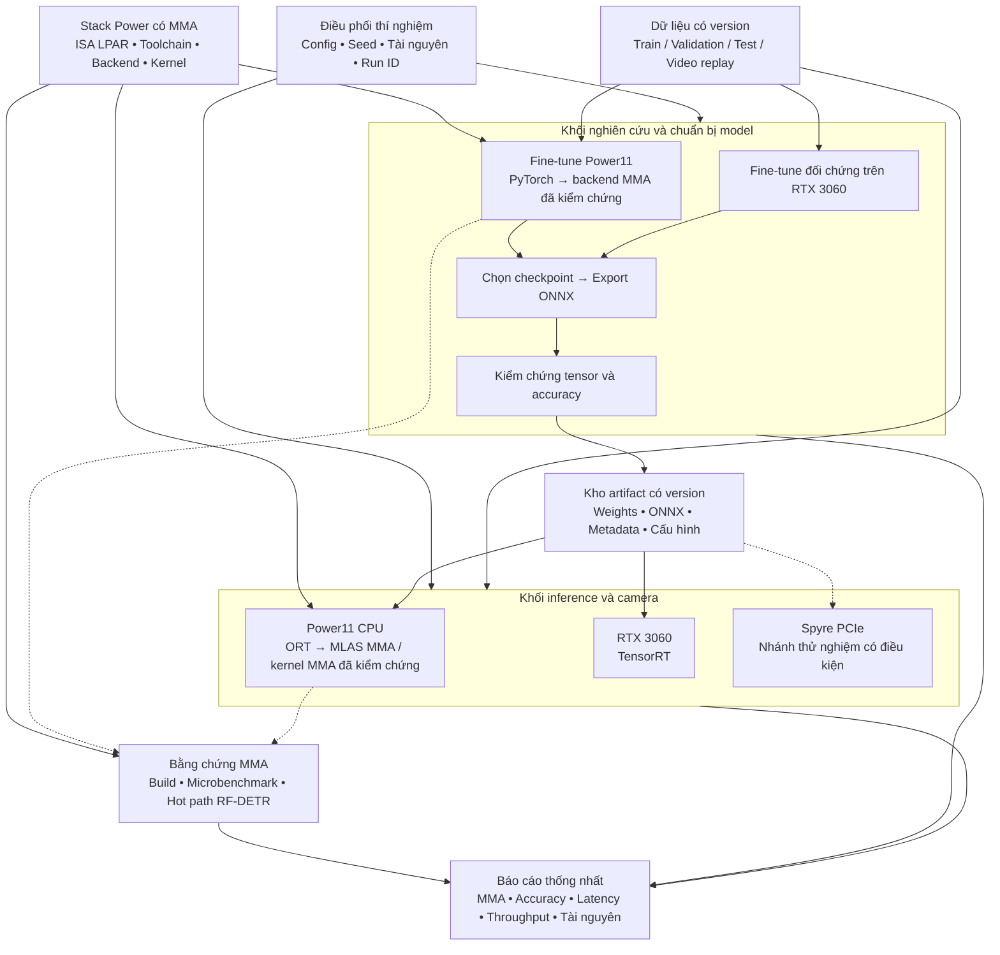
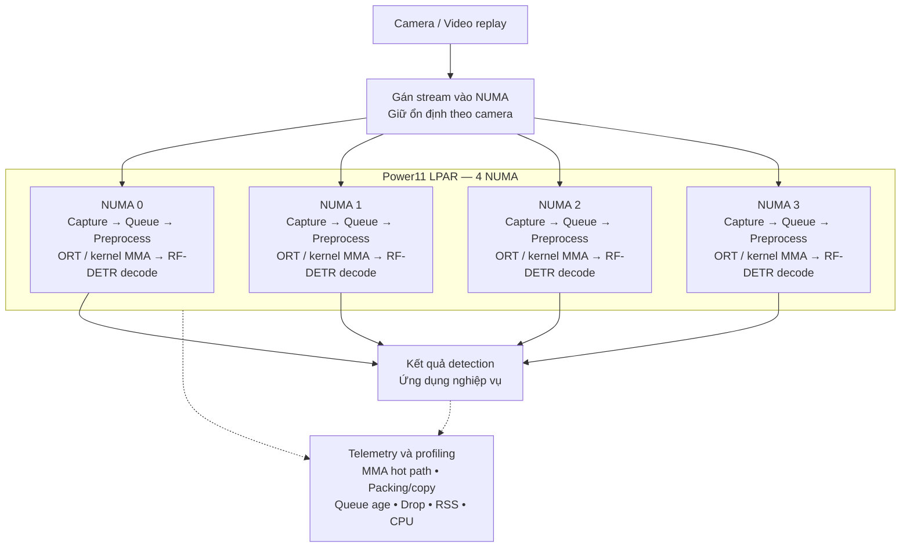
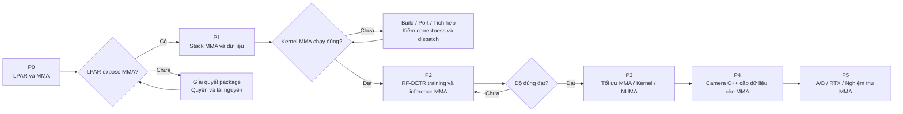
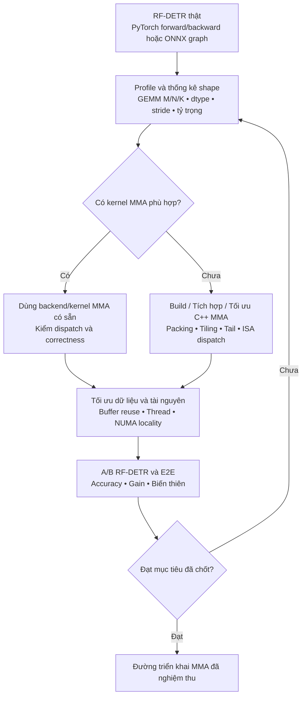

# Kế hoạch kiến trúc và tối ưu RF-DETR bằng MMA trên IBM Power11

Ngày lập: 25/11/2026.

Định hướng cập nhật: **khai thác và tối ưu CPU MMA ngay từ đầu**, cho cả training và inference trên Power11; phải có bằng chứng thực thi và kết quả đo.

## 1. Mục tiêu và phạm vi

Triển khai theo thứ tự: **xác nhận MMA trong LPAR → chọn/build stack có kernel MMA → kiểm chứng trên RF-DETR → tối ưu kernel, thread và NUMA → pipeline camera C++ → đối chứng và nghiệm thu**. Dự kiến 4 tuần khi stack MMA có sẵn và tương thích; thời gian training dài, port dependency hoặc phát triển kernel mới được dự toán riêng sau P1.

Kế hoạch cần trả lời ba câu hỏi:

1. Power11 training RF-DETR được ở cấu hình nào, mất bao lâu để đạt accuracy mục tiêu?
2. Power11 phục vụ được bao nhiêu camera trong giới hạn latency và accuracy đã chốt?
3. Các phép nhân ma trận quan trọng của RF-DETR đã chạy qua MMA chưa, hiệu quả đo được là bao nhiêu và cần tối ưu kernel/C++/NUMA ở đâu để khai thác MMA tốt hơn?

Thông số mục tiêu do người dùng cung cấp: IBM Power11, RHEL 9.8 ppc64le, PowerVM, 240 logical CPU ở SMT8, 4 NUMA, RAM 954 GiB, `/home/models` 745G. P0 phải xác nhận lại topology, entitlement và tài nguyên thực sự được cấp cho tiến trình. Không coi 240 logical CPU là 240 core hoặc mặc định toàn bộ capacity luôn sẵn có.

Đường triển khai chính bắt buộc là **CPU Power11 có MMA, được xác minh trên workload RF-DETR**. Inference bắt đầu bằng ORT CPU/MLAS có kernel Power/MMA phù hợp; training dùng PyTorch với backend tính toán Power/MMA được kiểm chứng độc lập. Cài thêm OpenBLAS không tự thay backend của ORT, và chứng minh MLAS dùng MMA không chứng minh PyTorch training cũng dùng MMA.

MMA là tài nguyên tính toán trong CPU; Spyre là accelerator PCIe riêng. Spyre là nhánh mở rộng độc lập, không thay thế yêu cầu khai thác MMA của đường CPU.

**Yêu cầu kiến trúc:** MMA phải nằm trong đường thực thi của các hotspot nhân ma trận phù hợp ngay từ baseline được chọn để triển khai. Một đường CPU tham chiếu được giữ để kiểm correctness và đo cải thiện. Nếu chưa chứng minh được kernel MMA thực chạy thì chưa nghiệm thu nhãn “baseline tối ưu MMA”.

Không yêu cầu mọi operator chạy MMA: resize, softmax, normalization, thao tác dữ liệu và decoder có thể dùng CPU/VSX hoặc kernel khác. Phải tối ưu chúng để không làm nghẽn đường MMA và báo rõ phần chưa được tăng tốc. Với ma trận nhỏ mà MMA không có lợi, cho phép dispatch sang kernel thích hợp dựa trên số đo.

## 2. Kiến trúc tổng thể

Hệ thống gồm khối nghiên cứu, kho artifact có version và khối inference/camera. Bộ điều phối dùng cấu hình và Run ID để liên kết mọi phép đo với dữ liệu, model và tài nguyên đã sử dụng.

### Trách nhiệm từng thành phần

| Thành phần | Trách nhiệm | Đầu ra |
|---|---|---|
| Kho dữ liệu | Quản lý split bất biến, nhãn, ảnh và video replay | Dataset manifest, version và hash |
| Bộ điều phối | Chọn cấu hình, cấp ngân sách tài nguyên, tạo Run ID và chạy chiến dịch | Config, trạng thái và log của từng run |
| Stack Power/MMA | Chọn hoặc build toolchain/backend, kiểm ISA dispatch, correctness và hiệu năng kernel | Binary/version/hash, build log, microbenchmark và bằng chứng hot path |
| Training | Fine-tune Power11 qua backend MMA đã kiểm chứng; đối chứng RTX cùng thiết kế | Checkpoint, loss, accuracy, thời gian, RSS và profile forward/backward |
| Export và validation | Chọn checkpoint, xuất ONNX, đối chiếu tensor và accuracy | ONNX, metadata, báo cáo parity |
| Kho artifact | Giữ model cùng cấu hình, nguồn checkpoint và dependency | Artifact có thể truy vết và tái lập |
| Inference | Thực thi RF-DETR qua ORT/MLAS MMA hoặc kernel MMA được tích hợp khi cần | Detection, timing stage/operator và mapping operator → kernel |
| Telemetry và báo cáo | Thu tài nguyên, tổng hợp accuracy/latency/throughput | CSV/JSON, bảng so sánh và kết luận |

Training và benchmark inference chạy thành các chiến dịch riêng để tránh tranh tài nguyên. Ban đầu kho artifact có thể là cấu trúc thư mục có version và manifest trong `/home/models`; chưa cần triển khai thêm dịch vụ registry.

## 3. Kiến trúc inference trong Power11

Tổ chức theo NUMA để cấp dữ liệu ổn định cho kernel MMA và hạn chế truy cập bộ nhớ từ xa. Mỗi NUMA có worker, ORT session có đường MMA và buffer riêng; capture/decode được tổ chức theo nhóm stream được gán vào NUMA đó. Buffer input/packing được tái sử dụng ở nơi runtime cho phép; đo riêng packing/copy và thời gian tính toán.

### Nguyên tắc phân bổ tài nguyên

- Bắt đầu với **một worker trên một NUMA**, sau đó mở rộng tới bốn NUMA. Một worker mỗi NUMA là cấu hình xuất phát để đo, chưa phải cấu hình tối ưu đã được chứng minh.
- Lấy CPU mask từ topology thực, không giả định CPU ID liên tục hoặc mỗi NUMA có số CPU bằng nhau.
- Khởi tạo model và buffer sau khi gắn affinity/memory policy để ưu tiên bộ nhớ cục bộ.
- Kiểm soát cả số worker và thread nội bộ ORT để tránh oversubscription. Đo thêm các giới hạn sibling tương ứng SMT1/2/4/8 bằng affinity, không tự thay SMT toàn hệ thống.
- Đo RSS theo worker trước khi tăng số bản sao model. RAM lớn không thay thế băng thông bộ nhớ hoặc capacity CPU được PowerVM cấp.
- Tách queue và bộ đếm theo camera để một stream chậm không làm nghẽn toàn hệ thống.
- Tối ưu số thread và kích thước công việc theo kernel MMA thực chạy; không dùng mặc định 240 thread. Tính cả packing, transpose, copy và băng thông bộ nhớ khi đánh giá lợi ích MMA.

### Chính sách queue

| Chế độ | Chính sách | Chỉ số cần ghi |
|---|---|---|
| Replay kiểm chứng | Xử lý đủ frame; khi đầy queue thì chờ | Frame ID, số frame, lỗi decode, thời gian xử lý |
| Live camera | Queue hữu hạn; ưu tiên frame mới theo chính sách đã chốt | Frame nhận/xử lý/bỏ, queue age, reconnect, output FPS |

Không cho phép backlog tăng vô hạn. Tuổi frame và sensor-to-result là hai chỉ số khác nhau: muốn đo sensor-to-result phải có timestamp nguồn và đồng bộ thời gian phù hợp.

RF-DETR detection dùng pipeline hậu xử lý đúng theo checkpoint: box decoding, sigmoid và top-k. Không tự đưa NMS hoặc logic Detect của YOLOv5-face vào RF-DETR.

## 4. Kế hoạch triển khai

| Giai đoạn | Công việc chính | Đầu ra và điều kiện chuyển bước |
|---|---|---|
| **P0 — Xác nhận hạ tầng và MMA** · 1–2 ngày | Kiểm LPAR, entitlement, ISA/MMA được expose, topology, NUMA, RAM/đĩa và toolchain. Tách CPU MMA với Spyre PCIe. | Hồ sơ tài nguyên; bằng chứng capability MMA; xác định quyền/tool còn thiếu. |
| **P1 — Dựng stack MMA và khóa thí nghiệm** · 2–4 ngày nếu có binary phù hợp | Chọn wheel/build Power có kernel MMA; kiểm riêng PyTorch backend và ORT/MLAS. Smoke microbenchmark ma trận và correctness. Đồng thời khóa model, dữ liệu, shape, precision và cấu hình đối chứng. | Hai đường CPU tham chiếu và MMA có version/hash; build log; microbenchmark; kế hoạch kiểm hot path RF-DETR. Nếu thiếu kernel phải mở việc port/tích hợp ngay ở đây. |
| **P2 — RF-DETR trên đường MMA** · 3–4 ngày, chưa tính train dài | Chạy CPU training ngắn, profile forward/backward để xác nhận backend/kernel MMA thực chạy. Export ONNX, kiểm eager–ONNX và profile inference thật. Đối chứng RTX cùng cấu hình. | Checkpoint/ONNX đúng; loss hữu hạn; parity/accuracy đạt; danh sách hotspot GEMM với shape và bằng chứng kernel thực chạy. |
| **P3 — Tối ưu MMA và NUMA** · 3–5 ngày, kernel mới dự toán riêng | Tối ưu dispatch, layout, packing/reuse, thread, sibling, NUMA và worker theo hotspot. Tích hợp/tối ưu C++ kernel MMA khi đường thư viện còn thiếu hoặc chưa đạt hiệu quả. Chạy A/B có kiểm soát. | Cấu hình MMA tốt nhất cho latency và throughput; báo gain, chi phí packing/copy, accuracy và phần operator còn fallback. |
| **P4 — Pipeline camera C++ cấp dữ liệu cho MMA** · 3–5 ngày | Đo replay/live; quản lý queue và buffer; tối ưu capture/decode/preprocess/postprocess theo profile. Giữ đường MMA đã kiểm chứng khi đưa vào service. | E2E cải thiện có số đo; queue/drop/age được kiểm soát; không mất lợi ích MMA do pipeline hoặc NUMA. |
| **P5 — Đối chứng và nghiệm thu MMA** · 2–3 ngày | Lặp cấu hình cuối, so với CPU tham chiếu và RTX TensorRT, soak test và kiểm lại MMA hot path dưới tải camera. | Báo cáo accuracy, model/E2E gain, capacity; hồ sơ chứng minh MMA; cấu hình vận hành và giới hạn. |

Các khoảng thời gian là **ước lượng công triển khai**, cần điều chỉnh sau P0 nếu dependency, dữ liệu hoặc quyền truy cập chưa sẵn sàng. Tổng công có thể trải rộng hơn 4 tuần nếu một người thực hiện toàn bộ hoặc các lượt training kéo dài.

## 5. Thiết kế benchmark training

Đường training Power11 phải được kiểm chứng MMA riêng: ghi cấu hình build PyTorch, thư viện tính toán thực liên kết, dtype, shape và hot path của forward/backward. Microbenchmark NumPy/OpenBLAS hoặc bằng chứng ORT dùng MMA không thay cho kiểm chứng training RF-DETR. Nếu một hotspot chưa có đường MMA phù hợp, lập việc tích hợp backend/kernel và đo lại, không gắn nhãn training tối ưu MMA chỉ từ tên package.

Training có hai phép đo riêng:

1. **Đối chứng cố định:** cùng checkpoint khởi tạo, dataset/split, seed, microbatch, accumulation, số epoch và precision. Phép đo này phục vụ so sánh thời gian, tài nguyên và hội tụ giữa Power11 và RTX.
2. **Khai thác từng phần cứng:** được thay batch, thread và loader worker để tìm cấu hình tốt nhất trên mỗi máy. Kết quả được báo riêng vì thay batch có thể làm thay đổi quá trình tối ưu.

Ghi thời gian load model, thời gian theo batch/epoch, tổng train wall, RSS và accuracy theo epoch. Báo cả tổng thời gian hoàn thành và thời gian đạt accuracy mục tiêu; không chỉ báo images/s.

Chạy smoke ngắn trước, sau đó mới mở training dài. Dùng validation để chọn checkpoint; giữ test set cho đánh giá cuối. Lặp nhiều seed khi kết luận về hội tụ. Run có profiler hoặc đồng bộ CUDA để đo batch được tách khỏi run đo tốc độ tự nhiên.

Nếu training stack ppc64le chưa vượt qua kiểm chứng dependency/operator, tiếp tục giải quyết nhánh đó riêng. Có thể dùng checkpoint/export từ máy NVIDIA để nghiên cứu inference Power11, nhưng không coi đó là đã benchmark training trên Power11.

## 6. Thiết kế benchmark inference

Đường inference triển khai phải dùng ORT/MLAS có kernel MMA hoặc kernel MMA được tích hợp cho các hotspot ma trận phù hợp. Kiểm trên model RF-DETR thật sau graph optimization; ghi operator/fused node → shape → kernel → precision. Không suy tất cả MatMul/Gemm/Conv đều được tăng tốc chỉ vì runtime có kernel MMA.

Tách ba tầng benchmark để xác định đúng nơi cần tối ưu.

| Tầng đo | Phạm vi | Câu hỏi cần trả lời |
|---|---|---|
| **Model-only** | Tensor đã preprocess → output model | Runtime, kernel, thread và NUMA hoạt động thế nào? |
| **Pipeline replay** | Đọc/decode → preprocess → inference → postprocess | Ngoài model, stage nào chiếm thời gian? |
| **Live camera** | Nhận stream → kết quả ứng dụng | Có đáp ứng FPS, latency và độ mới của frame khi chạy lâu không? |

Mỗi lượt lưu Run ID, model/data hash, precision, affinity, memory policy, số worker, thời gian khởi tạo, warmup, p50/p95/p99, throughput, RSS và telemetry. Lượt profile operator được tách khỏi lượt đo KPI.

### Ma trận thí nghiệm

| Nhóm | Biến thay đổi | Giữ cố định |
|---|---|---|
| MMA và đối chứng CPU | Đường kernel/dispatch hoặc stack tham chiếu đã kiểm chứng | Model, input, precision, tài nguyên; giữ các yếu tố khác giống nhau khi cô lập hiệu quả MMA |
| GEMM theo shape | M/N/K, batch, transpose/stride và packing lấy từ model thật | Correctness, dtype và phạm vi timer |
| Single worker | Thread count và sibling subset | Model, input, batch, precision, NUMA và binary MMA |
| NUMA | Local, spread hoặc chính sách bộ nhớ được khai báo rõ | Ngân sách CPU và workload |
| Multi-worker | Số worker và phân phối stream | Tổng tài nguyên đã cấp; mask không chồng nhau |
| Camera | Số stream, input FPS, codec/resolution | Model, logic tiền/hậu xử lý và chính sách queue |
| Precision/backend | CPU FP32, TensorRT FP32, cấu hình precision thấp riêng | Checkpoint, dữ liệu, shape và quy tắc accuracy |

Đo multi-worker bằng tổng frame hoàn thành trong cửa sổ chạy đồng thời thực tế; không cộng FPS của những lượt worker chạy riêng. Nếu phép đo gồm startup/warmup thì phải đặt tên và báo phạm vi đó, không gọi là steady-state throughput.

## 7. Đối chứng RTX 3060 và TensorRT

- Dùng cùng checkpoint, dữ liệu, input shape, batch và cách tiền/hậu xử lý.
- Đối chứng precision ban đầu là CPU FP32 và TensorRT FP32 với chính sách TF32 được kiểm soát, ghi nhận rõ.
- FP16/INT8 là các cấu hình tối ưu riêng, phải qua gate accuracy trước khi đưa vào so sánh.
- Tách device-only compute, host-call có transfer và pipeline camera. Không dùng một cột speedup chung cho các phạm vi khác nhau.
- Ghi CPU host NVIDIA, driver, CUDA, TensorRT, VRAM và engine build metadata. Chi phí decode/preprocess trên máy NVIDIA cũng thuộc E2E.
- Engine native TensorRT và ORT TensorRT EP có fallback là hai đường khác nhau; báo đúng backend và kiểm provider assignment nếu dùng ORT.

## 8. Tiêu chí nghiệm thu

Các giá trị mục tiêu nghiệp vụ cần chốt trong P1, trước chiến dịch đo chính.

| Nhóm | Điều kiện nghiệm thu |
|---|---|
| **Hạ tầng** | Có topology, entitlement/cpuset/quota và trạng thái Spyre đã xác nhận hoặc ghi rõ chưa xác nhận. |
| **Độ đúng** | Eager và ONNX qua kiểm tensor; mAP/recall được đo trên cùng test set. Budget giảm accuracy được thống nhất riêng cho FP32 và precision thấp. |
| **Hiệu năng** | Tối thiểu ba lần lặp cho cấu hình cuối; báo số mẫu và biến thiên. Không kết luận từ một lượt đo. |
| **Camera** | Chốt số camera, FPS mỗi camera, latency và tuổi frame tối đa; soak ít nhất một giờ; ghi reconnect, lỗi và drop. |
| **Tái lập** | Có cấu hình, phiên bản, hash, log và kết quả thô để chạy lại. |
| **MMA bắt buộc** | Có capability trong LPAR, build/backend đúng và bằng chứng kernel MMA thực chạy trên hotspot RF-DETR của training và inference. Tên CPU, package hoặc CPUExecutionProvider chưa đủ. |
| **Hiệu quả MMA** | Có A/B cùng điều kiện, numerical/accuracy gate và báo cải thiện model/E2E cùng biến thiên. Nếu chưa có lợi ích vượt nhiễu đo, tiếp tục xử lý layout/kernel/thread/pipeline; chưa tuyên bố tối ưu MMA đã đạt. |
| **Phần chưa tăng tốc** | Có bảng operator, tỷ trọng thời gian và lý do dùng MMA/VSX/kernel khác. Không yêu cầu operator không phù hợp phải chạy MMA. |

Biểu mẫu mục tiêu camera cần điền:

| Chỉ tiêu | Mục tiêu cần chốt |
|---|---|
| Số camera đồng thời | Chốt theo workload nghiệp vụ |
| Input FPS và FPS cần inference mỗi camera | Chốt riêng hai giá trị |
| Codec và resolution nguồn | Chốt theo camera thực |
| Latency p95/p99 | Chốt ranh giới timer và ngưỡng |
| Tuổi frame tối đa | Chốt timestamp nguồn/nhận và ngưỡng |
| Accuracy và recall lớp quan trọng | Chốt metric, split và budget suy giảm |
| Chính sách drop/reconnect | Chốt hành vi và cách ghi nhận |

## 9. Thiết kế tối ưu MMA ngay từ đầu

MMA là yêu cầu của đường thực thi ngay từ P0–P2. P3 tiếp tục cải thiện mức khai thác; không phải giai đoạn mới bắt đầu xem xét MMA.

### Hai đường để đo hiệu quả

| Đường | Mục đích | Quy tắc |
|---|---|---|
| **R0 — CPU tham chiếu** | Kiểm correctness và làm đối chứng hiệu năng | Ghi chính xác binary/dispatch; nếu chưa chứng minh không dùng MMA thì không gọi là “MMA off”. |
| **R1 — MMA tối ưu** | Đường triển khai chính | Có bằng chứng MMA hot path; cùng model/input/precision; tối ưu layout, packing, thread và NUMA có kiểm soát. |

Nếu cần cô lập riêng tác động MMA, dùng cùng revision và một thay đổi dispatch/kernel có kiểm soát trong build thí nghiệm, sau khi xác minh cơ chế trong source. Không giả định có cờ tắt MMA chung cho mọi runtime. Nếu đồng thời thay compiler, thư viện hoặc NUMA, kết quả chỉ phản ánh cải thiện của toàn stack, không quy toàn bộ gain cho MMA.

### Hạng mục kỹ thuật bắt buộc

1. **Chọn/build backend MMA từ đầu:** khóa revision, toolchain, ABI, build flags và wheel/shared-library hash. Xác nhận probe và source kernel thực được compile; không tự áp cờ compiler không được toolchain hỗ trợ.
2. **Kiểm kernel với shape thật:** trích M/N/K, batch, dtype, transpose và stride từ RF-DETR; đo cả shape nhỏ và tail. Kiểm numerical error, packing/copy và thời gian tính toán.
3. **Xác minh runtime:** dùng operator profile để tìm node, kết hợp call stack/symbol hoặc công cụ trace phù hợp để chứng minh hot path MMA. Binary chứa lệnh MMA chỉ chứng minh code có sẵn. Chỉ dùng PMU event có trên máy và đã kiểm cách diễn giải.
4. **Tối ưu C++/MMA khi có khoảng trống:** nếu hotspot phù hợp chưa được thư viện khai thác, port/tích hợp kernel hoặc custom op có kiểm correctness và fallback. Tính packing, alignment, tiling, tail và threading; không chỉ đo một phép GEMM lớn tách khỏi model.
5. **Tối ưu cung cấp dữ liệu cho MMA:** prepack trọng số bất biến hoặc reuse buffer ở nơi runtime hỗ trợ và có lợi; giảm transpose/copy, giữ NUMA locality, giới hạn các tầng thread pool. Giữ cùng phép biến đổi model và kiểm accuracy sau thay đổi.
6. **Đo toàn hệ thống:** chọn cấu hình theo model latency, tổng throughput và camera SLA. FP32 là đường correctness đầu tiên; BF16/FP16/INT8 chỉ dùng khi backend/kernel cho đúng Power11 hỗ trợ và accuracy gate cho phép. Không mặc định precision thấp luôn nhanh hơn.

Không thể xác nhận “tối ưu nhất” trước khi chạy sweep và kiểm trên server. Tiêu chí của kế hoạch là tối ưu MMA có bằng chứng, có đối chứng và có cấu hình tốt nhất trong phạm vi thí nghiệm đã công bố.

Nhánh Spyre tiếp tục độc lập: prototype compatibility rồi đo compile, partition graph, CPU fallback, transfer và E2E. Nhánh này không thay thế điều kiện nghiệm thu MMA của CPU.

## 10. Vai trò và bộ bàn giao

| Vai trò | Trách nhiệm |
|---|---|
| ML engineer | Dataset, RF-DETR, training/export, numerical parity và accuracy |
| Performance/backend engineer | Stack/kernel MMA ngay từ đầu, profiling hot path, C++/packing, worker/queue, affinity/NUMA và A/B benchmark |
| Quản trị PowerVM/IBM | Xác nhận entitlement, tài nguyên, PCIe assignment và stack hỗ trợ |
| Người phụ trách nghiệp vụ | Chốt camera workload, accuracy/latency SLA và nghiệm thu |

Bộ bàn giao cuối gồm sơ đồ kiến trúc, hồ sơ hạ tầng/ISA, stack MMA có version/hash, build log, microbenchmark shape RF-DETR, bằng chứng hot path training/inference, dataset/model manifests, checkpoint/ONNX, bảng operator → kernel, báo cáo A/B và camera E2E, đối chứng Power11–RTX, cấu hình vận hành và phần tối ưu còn lại.

## 11. Cơ sở lập kế hoạch

Báo cáo người dùng cung cấp “Báo cáo YOLOv5-face trên IBM Spyre v1.docx” cho thấy cần đo riêng model và các stage CPU của pipeline. Số đo YOLOv5-face/Spyre trong báo cáo không được chuyển thành dự báo hiệu năng RF-DETR CPU/MMA, và tài liệu đó không chứng minh bên NVIDIA sử dụng TensorRT.

Ảnh/đầu ra cấu hình gốc chưa truy xuất được trong phần tham chiếu cuộc trò chuyện; thông số hạ tầng đầu kế hoạch cần được xác nhận lại tại P0. Các lựa chọn kiến trúc và thời lượng ở trên là phương án triển khai đề xuất, chưa phải kết quả nghiệm thu phần cứng.

Nguồn kỹ thuật đã đối chiếu trong quá trình chuẩn bị baseline:

- [ONNX Runtime build và kiến trúc hỗ trợ](https://onnxruntime.ai/docs/build/inferencing.html)
- [MLAS và cấu hình kernel Power/MMA](https://github.com/microsoft/onnxruntime/blob/main/cmake/onnxruntime_mlas.cmake): mã nguồn có kiểm compiler/ISA và kernel Power10; phải xác minh lại đúng revision/binary được dùng trên Power11.
- [IBM Power-Optimized Python Wheels](https://www.ibm.com/docs/en/aiservices/2026.06.0?topic=matter-power-optimized-python-wheels): nguồn package Power10/Power11 ppc64le; không thay thế bằng chứng RF-DETR thực chạy MMA.
- [IBM Power10 MMA Performance Guide](https://www.ibm.com/support/pages/system/files/inline-files/Power10_Performance_Quick_Start_Guides.pdf): tham chiếu tối ưu MMA; thông số/tuning áp dụng cho Power11 phải được kiểm chứng trên máy đích.
- [RF-DETR training customization](https://rfdetr.roboflow.com/latest/learn/train/customization/)
- [RF-DETR ONNX inference](https://rfdetr.roboflow.com/latest/exports/onnx/)
- [IBM Spyre for Power](https://www.ibm.com/docs/en/ibm-spyre-for-power?topic=power-introduction-spyre-accelerator)
- [NVIDIA TensorRT performance benchmarking](https://docs.nvidia.com/deeplearning/tensorrt/latest/performance/benchmarking.html)

Sơ đồ trong file sử dụng Mermaid; cần trình xem Markdown có hỗ trợ Mermaid để hiển thị trực tiếp.
