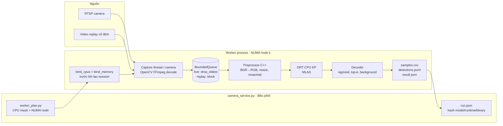
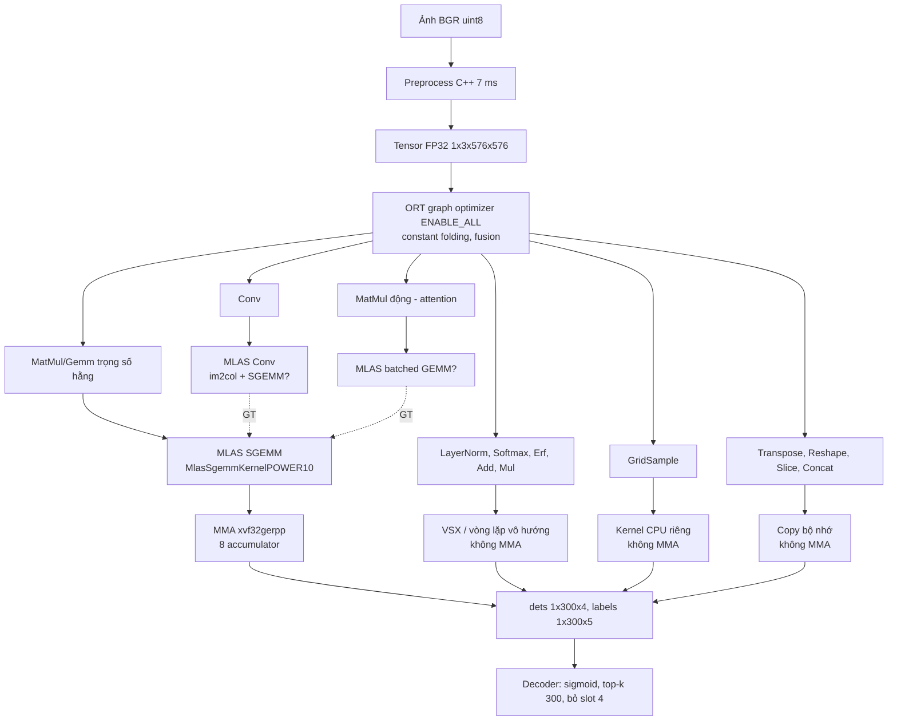
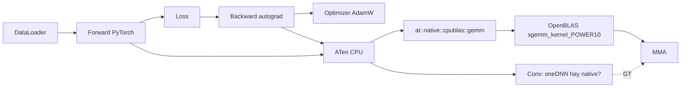
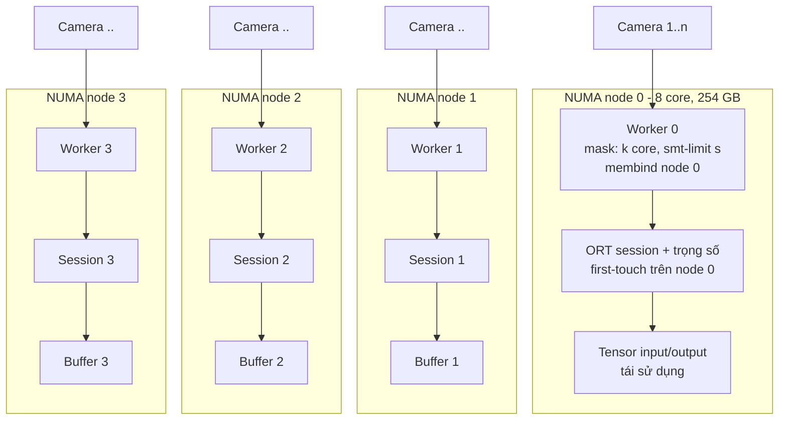
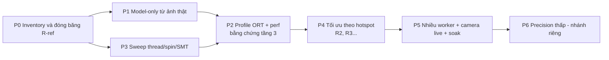

# Thiết kế kỹ thuật: RF-DETR 576 khai thác CPU MMA trên IBM Power11

Ngày lập: 27-11-2026. Phạm vi: suy luận RF-DETR Medium 576 FP32 trên CPU Power11 qua ONNX Runtime (ORT). Training và Spyre được mô tả như các nhánh riêng, không dùng để chứng minh hiệu quả CPU MMA.

Mỗi khẳng định trong tài liệu được gắn một trong ba nhãn sau:

- **[TL]** Đã xác minh từ tài liệu hoặc mã nguồn (có nguồn ở mục 10).
- **[ĐC]** Đã chạy thực tế trên server 10.0.1.70 (có số liệu hoặc output đã lưu).
- **[GT]** Giả thuyết, cần kiểm chứng. Không được dùng làm kết luận.

Mọi tối ưu đi theo một chuỗi cố định: **nút thắt → giả thuyết → thay đổi → correctness test → benchmark → giữ hoặc hoàn nguyên**.

---

## 0. Tóm tắt điều hành

| Câu hỏi | Trạng thái hiện tại |
|---|---|
| LPAR có expose MMA? | **Có [ĐC].** `AT_HWCAP2` có MMA, `lscpu` báo Power11, SMT8. |
| Backend ORT có kernel MMA? | **Có [ĐC].** ORT 1.27.0 (IBM wheel) chứa 336 lệnh MMA (họ `xvf32ger`, `xvi8ger4`, `xvbf16ger2`). |
| Kernel MMA có chạy trong ORT? | **Có, nhưng mới cho MatMul tổng hợp [ĐC].** Với MatMul 1024³ FP32 1 thread, `perf` cho `MlasSgemmKernelPOWER10` chiếm 84,7% mẫu, đạt 181,9 GFLOP/s. |
| Kernel MMA có chạy trong hot path RF-DETR? | **Chưa chứng minh.** Đây là việc ưu tiên số 1 (giai đoạn P2). |
| Hiệu năng hiện tại | Live 2,73 ± 0,02 FPS (3 lượt) [ĐC]. Replay cố định 3,14 ± 0,05 và 3,08 ± 0,07 FPS cho hai nhãn giống hệt (6 lượt xen kẽ) [ĐC]. |
| Ngưỡng phát hiện cải thiện | Khoảng 3,5% FPS với 3 lượt mỗi nhánh. Ước lượng từ phép đo nhiễu A/B, chưa phải kiểm định thống kê chính thức [ĐC]. |
| Có cần build ORT từ source để có MMA? | **Không, theo bằng chứng hiện có.** Wheel IBM đã dispatch kernel POWER10 lúc chạy. Chỉ build lại nếu profile cho thấy thiếu kernel cho operator quan trọng. |

Phép ước lượng số học ở mục 6.2 cho thấy phần GEMM tuyến tính của backbone chỉ khoảng 59 GFLOP mỗi frame. Nếu MLAS giữ được 182 GFLOP/s mỗi thread thì 4 thread cần cỡ 80 ms. Inference đo được lại là khoảng 336 ms. **Khoảng chênh này là giả thuyết trung tâm [GT]:** phần lớn thời gian có thể nằm ngoài kernel SGEMM MMA (attention MatMul động, Softmax, LayerNorm, GridSample, copy/transpose) hoặc ở hiệu quả threading. Chỉ profile mới phân xử được.

---

## 1. Kiến trúc tổng thể

### 1.1 Hạ tầng đã đọc được trên LPAR [ĐC]

| Thuộc tính | Giá trị đọc được | Nguồn |
|---|---|---|
| CPU | Power11, ppc64le, SMT8, 240 logical CPU | `lscpu` |
| Kiểu LPAR | Shared, Uncapped, Entitled Capacity 14,50 | `lparstat -i` |
| Virtual CPU | 30 online, tối đa 64 | `lparstat -i` |
| Shared pool | 15 physical CPU, Maximum Capacity of Pool 15,00 | `lparstat -i` |
| NUMA | 4 node, bộ nhớ 254 / 245 / 245 / 233 GB | `numactl --hardware` |
| CPU theo node | node 0: 0–7, 32–39, 64–71, …; node 1: 8–15, 40–47, 72–79, … | `numactl --hardware` |
| GCC hệ thống | 11.5.0 (Red Hat 11.5.0-14) | `gcc --version` |
| CMake | 3.31.8 | `cmake --version` |
| Spyre | 8 thiết bị trong `lspci`, bind `vfio-pci`, runtime chưa xác minh | `lspci -k` |

Hai hệ quả thiết kế:

1. **Ngân sách CPU thực là khoảng 15 core vật lý, không phải 240.** Pool chỉ có 15 physical CPU, nên 30 VCPU chia sẻ 15 core. Power10 Quick Start khuyên số VCPU không vượt số core trong shared pool và đặt entitlement gần mức sử dụng trung bình [TL, P10 QS – PowerVM Best Practices]. Cấu hình hiện tại (30 VCPU trên pool 15) vượt khuyến nghị đó. Đây là hạng mục cho quản trị viên PowerVM, không phải việc repo tự đổi.
2. **Một mô hình nên nằm gọn trong một NUMA node, và bộ nhớ cấp từ cùng node** [TL, SG24-8592 §5.2]. Mỗi node có 64 logical CPU, tức 8 core SMT8. Trên LPAR shared, việc này giảm nhảy node nhưng không đảm bảo core vật lý cố định, vì hypervisor vẫn dispatch VCPU. Có thể đọc điểm affinity bằng `lparnumascore` (powerpc-utils) [TL, P10 QS – Enterprise Linux].

### 1.2 Sơ đồ khối



Thành phần hiện có trong repo [ĐC, mã nguồn]:

- `core/src/camera_pipeline.cpp`: một capture thread và một queue cho mỗi camera, một consumer inference mỗi worker, chạy round-robin.
- `core/src/ort_session.cpp`: `intra_op=threads`, `inter_op=1`, `ORT_SEQUENTIAL`, `ORT_ENABLE_ALL`, `session.intra_op.allow_spinning=0`.
- `core/src/placement.cpp`: bind CPU và memory policy trước khi nạp model (lỗi EINVAL khi bind NUMA đã được sửa, có regression test).
- Timer inference đo đến khi `session.Run()` đồng bộ trả về, không chỉ đo lúc enqueue.

---

## 2. Đường thực thi xuống kernel MMA

### 2.1 Inference

Dữ liệu dưới đây đếm trực tiếp từ graph `rfdetr_medium_traffic_576.onnx` (SHA256 bắt đầu `7592fd8c808c3547`, opset 17, 1666 node, 30 039 234 tham số) [ĐC, đọc graph].

| Nhóm operator | Số node | Kích thước trọng số tiêu biểu | Ý nghĩa kiến trúc |
|---|---|---|---|
| MatMul với trọng số hằng | 119 | 384×384 (48), 384×1536 (12), 1536×384 (12), 256×256 (30), 256×2048 (4), 2048×256 (4) | Backbone ViT 12 block hidden 384 (q, k, v, proj và MLP), decoder 256, FFN 2048 |
| MatMul động (hai input là activation) | 32 | không có | Q·Kᵀ và attn·V của self-attention |
| Gemm | 4 | nhỏ | Head |
| Conv | 9 | 384×3×16×16 (patch embed), 128×128×3×3 (6), 1×1 (2) | Patch 16, tức 36×36 = 1296 token ở 576; projector đa tỉ lệ |
| LayerNormalization | 51 | | |
| Softmax | 20 | | Attention |
| Erf | 12 | | GELU trong MLP backbone |
| GridSample | 4 | | Deformable attention của decoder (4 lớp) |
| Transpose / Reshape / Slice / Concat | 125 / 137 / 67 / 28 | | Chuyển layout, chia window/head |



Trạng thái từng nhánh:

| Nhánh | Đường MMA phù hợp? | Trạng thái |
|---|---|---|
| MatMul trọng số hằng → SGEMM | Có. GEMM FP32 là dạng MMA hướng tới [TL, REDP-5612 ch.3–4] | Kernel POWER10 chạy thật trên MatMul tổng hợp [ĐC]. Trên RF-DETR: **[GT]**, cần P2. |
| Conv | Có thể, nếu MLAS hạ về SGEMM | **[GT].** Cần symbol của `perf` lúc Conv chạy. |
| MatMul động (attention) | Có thể, nếu MLAS dùng batched SGEMM không prepack | **[GT].** Đây là nghi vấn lớn vì shape phụ thuộc số token và window. |
| LayerNorm, Softmax, Erf, Add/Mul | Không. Đây là phép từng phần tử hoặc rút gọn, không phải tích ngoài | Chạy VSX hoặc vô hướng. Tối ưu bằng fusion hoặc VSX, không bằng MMA. |
| GridSample | Không | Kernel truy cập bộ nhớ ngẫu nhiên. |
| Transpose/Reshape/Concat | Không | Chi phí copy. Giảm bằng fusion hoặc layout. |

Ảnh hưởng của graph optimizer: ORT có thể gộp hoặc đổi operator khi `ORT_ENABLE_ALL`, ví dụ fusion LayerNorm hoặc GELU, hay MatMul+Add thành FusedMatMul/Gemm. Bảng hotspot vì vậy phải lấy từ **graph đã tối ưu** mà session lưu ra (`optimized_model` trong `benchmark.py`). Không lấy từ graph gốc ở trên. Graph gốc chỉ dùng để nhận diện kiến trúc.

### 2.2 Tích hợp kernel hoặc custom operator khi backend thiếu

Chỉ làm sau khi P2 chỉ ra một operator cụ thể vừa tốn thời gian vừa không đi qua kernel MMA hiệu quả:

1. **Custom operator ORT (C++).** Đăng ký một custom op domain riêng, thay node đích trong ONNX bằng script có kiểm hash. Kernel nằm trong một translation unit riêng biên dịch `-mcpu=power10 -mmma`, giống cách repo đang làm với `core/src/gemm_mma.cpp`. Dispatch lúc chạy theo `AT_HWCAP2 & PPC_FEATURE2_MMA`. Nếu không có MMA thì dùng một fallback tham chiếu có cùng kết quả số học trong ngưỡng.
2. **Không sửa MLAS tại chỗ** trừ khi có bản build ORT từ source riêng, có commit và hash (xem `docs/BUILD_ORT.md`).
3. **Kernel repo hiện tại chưa đủ để thay MLAS.** Kernel 4×4 một accumulator chỉ đạt khoảng 33 GFLOP/s, so với 182 GFLOP/s của MLAS và 190 GFLOP/s của OpenBLAS (torch), cùng 1 thread [ĐC]. REDP-5612 §4.1 chỉ ra cách khắc phục: dùng cả 8 accumulator và tile 8×16 FP32, nạp cặp bằng `lxvp`, sao cho cứ 6 lần nạp vector thì có 8 lệnh `gerpp` [TL]. Kernel riêng chỉ đáng làm cho shape mà MLAS kém, ví dụ M nhỏ hoặc K lẻ.

### 2.3 Training (nhánh riêng)



- **Backend training độc lập với inference.** PyTorch 2.13.0 (IBM wheel) dùng OpenBLAS 0.3.32 đóng gói trong `torch.libs`. Trên `a @ a` 2048² 1 thread, `perf` cho `sgemm_kernel_POWER10` chiếm 67,7% mẫu, với call stack qua `at::native::cpublas::gemm` [ĐC]. Bằng chứng ORT/MLAS không áp dụng cho PyTorch, và ngược lại.
- SG24-8592 §5.5.2 cảnh báo có bản OpenBLAS trong wheel devpi được cấu hình kiến trúc Power9, khi đó "MMA kernels might not be compiled" [TL]. Bản torch đang dùng đã có symbol POWER10 thật trong `perf`, nhưng **mỗi wheel mới phải kiểm lại**.
- Conv và backward của Conv có thể đi qua oneDNN hoặc kernel native, chưa xác minh [GT]. Bằng chứng training phải là `perf` trên chính một bước train RF-DETR, không phải microbenchmark NumPy.
- Repo hiện đã bỏ training (theo quyết định của chủ dự án). Mục này chỉ là thiết kế để mở lại khi cần.

---

## 3. Worker, queue, buffer theo NUMA



Thứ tự khởi tạo trong worker [ĐC, mã nguồn]:

1. Đọc mask và node từ plan.
2. Kiểm tra mask nằm trong cpuset hiện có.
3. `bind_cpus`, sau đó `bind_memory(node)`. Nếu một trong hai lỗi thì worker thất bại, không tự hạ cấp.
4. Tạo ORT session. Trọng số và prepack được cấp phát sau khi bind, nên first-touch rơi vào node đúng.
5. Tạo buffer preprocess và tensor (tái sử dụng giữa các frame).
6. Khởi động capture thread và warmup.

Kiểm soát thread pool:

- **ORT intra-op:** đặt bằng số CPU trong mask. **Inter-op:** bằng 1 với `ORT_SEQUENTIAL`. Tài liệu ORT ghi rằng khi đặt số thread tường minh thì ORT không tự gán affinity [TL, ORT threading]. Repo đã bind ở mức process.
- **Capture/FFmpeg** chạy trên cùng mask. Thread của codec không bị `cv::setNumThreads(1)` khống chế hoàn toàn (xem `docs/CORE.md`). Khi sweep cần ghi số thread thực của process.
- **Spinning:** repo đặt `allow_spinning=0`, trong khi mặc định của ORT là 1 [TL, ORT threading]. Tắt spinning giảm chiếm CPU trên LPAR shared nhưng có thể làm tăng độ trễ đồng bộ giữa các thread. Đây là ứng viên R2 rẻ nhất (mục 6.4).
- **Không chồng mask** giữa các worker. Tổng thread của mọi worker không vượt khoảng 15 core vật lý của pool nếu tính theo core (mục 1.1).

Hai cấu hình đích được tối ưu riêng [TL, `docs/SYSTEM.md`]:

| Mục tiêu | Cấu hình khởi đầu | Biến được sweep |
|---|---|---|
| Latency thấp nhất (1 camera) | 1 worker, 1 node | thread 2/4/6/8, smt-limit 1/2/4 |
| Throughput tổng cao nhất | 1–4 worker, mỗi worker một node | thread mỗi worker, số worker, tổng không vượt ngân sách pool |

Queue: mỗi camera có `BoundedQueue` riêng. Live dùng `drop_oldest` và tùy chọn `max_frame_age_ms`. Replay dùng `block`, có `expected_frames` để kiểm đủ frame. Reconnect hữu hạn bằng `reconnect_attempts` và `reconnect_delay_ms` [ĐC, mã nguồn].

---

## 4. Ma trận phần mềm và build

| Lớp | Phiên bản đang dùng | Nguồn và cách cài | Bằng chứng |
|---|---|---|---|
| OS | RHEL 9.8, ppc64le | Có sẵn | [ĐC] |
| Python | 3.12 (venv `.venv-cpu` từ conda env `rfdetr-cpu`) | Không đụng Python hệ thống | [ĐC] |
| ORT Python | 1.27.0, IBM wheel, `CPUExecutionProvider` | Wheelhouse offline, `pip check` sạch | [ĐC] |
| ORT C++ SDK | Header từ NuGet 1.27.0 (`ORT_API_VERSION` 27) cộng `libonnxruntime.so.1.27.0` và `libprotobuf-lite` lấy từ wheel IBM, đặt tại `/home/models/stack/onnxruntime-1.27.0` | Tự lắp ráp | [ĐC]. Phải ghi SHA256 của `.so` vào `run.json` (đã có). |
| MLAS | Theo wheel ORT 1.27.0 | Không build lại | `MlasSgemmKernelPOWER10` chạy thật trên MatMul tổng hợp [ĐC] |
| OpenCV | 4.13 (conda-forge, headless, FFmpeg) tại `/home/models/stack/opencv4` | Prefix riêng | [ĐC]. `cv2` 5.0.0 trong venv **không có FFmpeg**, không đọc được RTSP [ĐC]. |
| Compiler cho core | GCC 11.5.0 hệ thống | Có sẵn | Probe CMake `-mcpu=power10 -mmma` biên dịch được MMA builtin [ĐC] |
| Link camera | `LDFLAGS="-Wl,-rpath,$C -Wl,--no-as-needed $C/libstdc++.so.6"` | Vì OpenCV conda cần `GLIBCXX_3.4.32` | [ĐC] |
| CMake | 3.31.8 | Có sẵn | [ĐC] |
| PyTorch (training/export) | 2.13.0 IBM wheel, OpenBLAS 0.3.32 trong `torch.libs` | venv riêng | `sgemm_kernel_POWER10` chạy thật [ĐC] |
| RF-DETR | Export ONNX làm trên máy dev x86 | venv export riêng | Phiên bản gói chưa ghi vào manifest. **Thiếu.** |

Quy tắc build:

- `-mcpu=power10` chỉ áp cho translation unit chứa MMA, không áp toàn binary [TL, P10 QS – GCC: object `-mcpu=power10` không chạy trên Power9 trở về trước]. Power10 và Power11 cùng ISA 3.1, và kernel của OpenBLAS được đặt tên Power10 theo ISA chứ không theo thế hệ chip [TL, SG24-8592 §5.5].
- `-mcpu=power11` được SG24-8592 §5.3.2 nhắc đến nhưng **chưa kiểm GCC 11.5.0 có hỗ trợ không**. Phải chạy probe biên dịch trước khi dùng, không mặc định.
- GCC ≥ 10 và LLVM ≥ 12 hỗ trợ MMA builtin [TL, REDP-5612 ch.5; P10 QS]. P10 QS khuyên GCC 11.2 trở lên để có đủ tính năng ISA 3.1. GCC 11.5 thỏa điều kiện này.
- Tên builtin cần chú ý: REDP-5612 dùng `__builtin_mma_assemble_acc`, còn trang Open XL 17.1.1 liệt kê `__builtin_mma_build_acc` [TL]. Mã repo chỉ dùng `xxsetaccz`, `xvf32gerpp`, `disassemble_acc`, là các tên có mặt ở cả hai nguồn.
- Trước khi dùng cờ nào, chạy `bash scripts/probe_mma_toolchain.sh` trên server (chỉ đọc, biên dịch chương trình nhỏ trong thư mục tạm). Script kiểm: builtin MMA biên dịch được với `-mcpu=power10 -mmma`; compiler có nhận `-mcpu=power11` không; và `AT_HWCAP2` có `PPC_FEATURE2_MMA`/`ARCH_3_1`. Đây là cách trả lời mục "GCC 11.5 có hỗ trợ `-mcpu=power11` không" bằng thực nghiệm thay vì tin một trang tổng quan.
- Mỗi build ghi `build-manifest.json` (hash nguồn và sản phẩm), `configure.log`, `build.log`, `ctest.log` (`scripts/build_core.sh`).
- **Không thêm cờ ORT kiểu `--enable_mma` hay `--use_openblas`.** Không tài liệu chính thức nào nêu các cờ này. MLAS tự probe compiler và tự dispatch theo HWCAP [TL, `docs/SUPPORT.md`, `docs/BUILD_ORT.md`].

---

## 5. Quy trình chứng minh MMA thực chạy

### 5.1 Ba tầng bằng chứng

| Tầng | Câu hỏi | Bằng chứng chấp nhận | Trạng thái |
|---|---|---|---|
| 1. LPAR | CPU có expose MMA cho process? | `AT_HWCAP2` có `PPC_FEATURE2_MMA` và `ARCH_3_1`; `rfdetr_gemm --capability` báo `exposed: true` | **Đạt [ĐC]** |
| 2. Binary | Thư viện đang được load có kernel MMA và có đường dispatch? | `objdump -d` trên đúng file `.so` mà process load (hash khớp `run.json`) có lệnh `xvf32ger*`; symbol `MlasSgemmKernelPOWER10` tồn tại | **Đạt [ĐC].** 336 lệnh MMA. |
| 3. Hot path RF-DETR | Khi RF-DETR chạy, CPU có thực thi kernel đó ở các operator ma trận? | (a) `perf record -g` trên process `rfdetr_camera` (hoặc model-only) đang chạy RF-DETR, symbol MMA chiếm tỉ trọng đáng kể; (b) call stack nối về node MatMul/Conv của ORT; (c) ORT profile cho thấy các node đó chiếm phần lớn thời gian | **Chưa có** |

Các dấu hiệu sau **không đủ** cho tầng 3: tên Power11, `CPUExecutionProvider`, binary chứa lệnh MMA, OpenBLAS đã cài, FPS tăng, hoặc `strings libopenblas.so | grep power10` (cách kiểm liên kết trong SG24-8592 §5.5.1) [TL].

### 5.2 Lệnh thu bằng chứng tầng 3

Lượt profile phải tách khỏi lượt đo KPI.

```bash
cd /root/Workspaces/IBM-Power-11-
# (a) ORT operator profile: bật profile trong một config replay RIÊNG
python - <<'E'
import json
c = json.load(open('configs/replay-rfdetr-a-local.json'))
c['session']['profile'] = 1
json.dump(c, open('configs/replay-rfdetr-profile-local.json', 'w'), indent=2)
E
python scripts/camera_service.py --config configs/replay-rfdetr-profile-local.json \
  --output runs/p2-ortprofile
# profile_path nằm trong result.json của worker
P=$(python -c "import json,glob;print(json.load(open(glob.glob('runs/p2-ortprofile/worker-*/result.json')[0]))['profile_path'])")
python scripts/profile_ops.py "$P" --output runs/p2-ortprofile/ops.csv --shapes runs/p2-ortprofile/shapes.json

# (b) perf trên chính process RF-DETR, terminal thứ hai trong lúc replay đang chạy
PID=$(pgrep -n rfdetr_camera)
perf record -F 999 -g -p "$PID" -o runs/p2-perf.data -- sleep 30
perf report -i runs/p2-perf.data --stdio --no-children --sort dso,symbol | head -60 > runs/p2-perf-top.txt
perf report -i runs/p2-perf.data --stdio --children --symbol-filter=Mlas | head -120 > runs/p2-perf-mlas.txt
```

- Chạy (b) trên một lượt replay **không bật profile ORT**, vì profile ORT làm thay đổi thời gian.
- Tên PMU event phải lấy từ `perf list` trên đúng server. Không tự đặt tên event đếm lệnh MMA. Nếu không có event phù hợp, tầng 3 dựa vào symbol và call stack.
- Lưu `perf` version, kernel và quyền (`/proc/sys/kernel/perf_event_paranoid`) cùng output.

### 5.3 Quy kết lợi ích cho MMA

MLAS không có công tắc tắt MMA được tài liệu hóa, và tài liệu này không bịa ra công tắc đó. Vì vậy không có phép A/B "MMA bật/tắt" trực tiếp trên ORT. Phần lợi ích của MMA được quy kết bằng ba cách:

1. Tỉ trọng thời gian của các symbol MMA trong `perf` trên RF-DETR (tầng 3).
2. Microbenchmark trên **shape thật** của RF-DETR (lấy từ `shapes.json`), so kernel MMA với đường tham chiếu VSX hoặc vô hướng của repo (`gemm_sweep.py --backends reference mma`). Đây là so sánh ở mức kernel, ghi rõ `--comparison kernel` trong `compare_runs.py`.
3. Khi đổi cả stack (compiler, backend, NUMA), báo là **cải thiện toàn stack**, không quy hết cho MMA.

Có thể gọi R0 là "MMA off" chỉ khi có một bản build đã chứng minh không chạy kernel MMA. Hiện tại không có bản như vậy.

Dùng `scripts/mma_evidence.py --workload inference` để kiểm tính nhất quán của hồ sơ bằng chứng (hash, trace đính kèm) sau khi đã có output thật.

---

## 6. Hotspot và công việc tối ưu C++/MMA

### 6.1 Bảng hotspot (khung, điền sau P2)

| # | Operator/node | Tỉ trọng thời gian | Shape / M·N·K | Dtype / layout / stride | Kernel thực chạy | Bằng chứng MMA | Hướng tối ưu |
|---|---|---|---|---|---|---|---|
| 1 | | | | FP32 | | | |
| … | | | | | | | |
| 10 | | | | | | | |

Nguồn điền bảng: `ops.csv` (tỉ trọng, shape), `shapes.json` (M/N/K cụ thể), `p2-perf-*.txt` (kernel và symbol). Mỗi dòng ghi rõ cột nào là [ĐC] và cột nào là [GT].

### 6.2 Ước lượng khối lượng tính toán [GT, số học từ graph]

Phép tính này là ước lượng để định hướng profile, không phải số đo.

- **Backbone, mỗi block:** 4 phép chiếu 384×384 và MLP 384↔1536 trên T token. Số MAC bằng T·384·(4·384 + 2·1536) = T·384·4608. Với T ≈ 1297 (1296 patch và có thể thêm token đặc biệt), mỗi block khoảng 2,3·10⁹ MAC. 12 block cho khoảng 27,5 GMAC, tức 55 GFLOP.
- **Projector Conv, patch embed, decoder:** thêm vài GMAC.
- **Attention động:** nếu attention là toàn cục thì Q·Kᵀ và attn·V cộng lại khoảng 2·T²·384 MAC mỗi block, tức tới khoảng 31 GFLOP cho 12 block. RF-DETR dùng windowed attention ở một số block, nên con số thật nhỏ hơn. Cần shape thật từ profile.

Từ đó:

- Ở 182 GFLOP/s mỗi thread (MLAS, MatMul 1024³) [ĐC], phần GEMM tuyến tính tốn cỡ 0,3 giây trên 1 thread, hay cỡ 80 ms trên 4 thread nếu scale tuyến tính.
- Inference đo được trung bình 336–351 ms trên 4 thread [ĐC].
- **Giả thuyết cần phân xử bằng P2:** (H1) attention MatMul động không đi qua đường SGEMM có prepack, hoặc có M/N nhỏ làm hiệu suất thấp; (H2) phép từng phần tử (Softmax trên 6 head × T × T, LayerNorm, Erf) và copy (Transpose/Reshape) chiếm phần lớn; (H3) scale 4 thread kém trên LPAR shared, hoặc `allow_spinning=0` làm tăng chi phí đồng bộ; (H4) GridSample hoặc decoder tốn nhiều hơn dự kiến.

### 6.3 Hạng mục phân tích ứng với từng hotspot

| Chủ đề | Cách đo | Khi nào hành động |
|---|---|---|
| Packing / prepack trọng số | `perf` tách `MlasSgemmPackedOperation` hoặc symbol pack so với kernel | Khi chi phí pack lặp lại mỗi lần Run |
| Transpose / copy / allocation | Tỉ trọng Transpose/Reshape/Concat trong `ops.csv`; symbol `memcpy` trong `perf` | Khi tổng copy lớn hơn khoảng 10% inference |
| Alignment, tile, tail, ma trận nhỏ | `gemm_sweep.py` trên `shapes.json`, so GFLOP/s theo shape | Khi shape thật đạt dưới khoảng một nửa GFLOP/s của 1024³ |
| Threading, cache, băng thông | Sweep thread (`ab_interleaved.py`), so GFLOP/s mỗi thread ở 1/2/4/8 thread | Khi scale dưới tuyến tính rõ rệt |
| SMT | smt-limit 1/2/4 ở cùng số core | Mỗi core có 4 engine MMA 512-bit dùng chung giữa các thread SMT [TL, SG24-8592 §5.3; P10 QS]; lợi hay hại phải đo |

Microbenchmark phải dùng shape từ RF-DETR thật và đo cả chi phí chuẩn bị dữ liệu (pack, transpose) lẫn tính toán.

### 6.4 Hàng đợi ứng viên R2 (mỗi lần chỉ đổi một yếu tố)

| Ưu tiên | Thay đổi | Nút thắt nhắm tới | Giả thuyết | Correctness | Benchmark | Giữ khi |
|---|---|---|---|---|---|---|
| 1 | Số thread 2/4/6/8 (cùng node, smt-limit 1) | Scale thread (H3) | 4 thread chưa tối ưu; đã từng thấy 7 thread chậm hơn 4 ở model-only | Output bit-gần (chỉ khác thứ tự cộng) | `runs/ab-threads1` (đang chạy) | Lợi ích > 3,5% FPS, p95 không xấu đi vượt nhiễu |
| 2 | `session.intra_op.allow_spinning` 0 → 1 | Đồng bộ thread (H3) | Spin giảm độ trễ đánh thức giữa các op song song | Như trên | A/B 3+3 lượt replay | Như trên, và CPU busy của LPAR không tăng gây hại cho worker khác |
| 3 | smt-limit 2 ở cùng số core | Tận dụng core | Thread SMT phụ che độ trễ bộ nhớ của op không MMA | Như trên | A/B | Như trên |
| 4 | Theo kết quả P2: fusion attention, kernel Softmax/LayerNorm VSX, hoặc custom op MMA cho shape attention | H1/H2 | Phụ thuộc bảng hotspot | So tensor với R-ref trên N frame thật | A/B và microbenchmark shape thật | Như trên và qua accuracy gate |
| 5 | Nhiều worker (2, 4) | Throughput tổng | Mỗi worker một node tăng tổng FPS tới khi chạm ngân sách pool | Từng worker như trên | Chạy đồng thời, tính theo cửa sổ chung | Tổng FPS tăng vượt nhiễu, latency từng camera chấp nhận được |
| 6 | INT8 (QGEMM, `xvi8ger4`) hoặc BF16 | Tính toán GEMM | Kernel số nguyên hoặc bf16 nhanh hơn FP32 | **Thí nghiệm riêng**, chỉ khi accuracy gate cho phép | Riêng | Không trộn vào phép đối chứng FP32 |

Quy tắc chung: viết custom kernel MMA là bước cuối. Chỉ làm khi P2 chứng minh một operator vừa lớn vừa không có kernel thư viện hiệu quả, và microbenchmark trên shape thật cho thấy có khoảng trống.

---

## 7. Benchmark, correctness và tiêu chí nghiệm thu

### 7.1 Ba phép đo tách riêng

| Phép đo | Công cụ | Ranh giới timer | Ghi chú |
|---|---|---|---|
| Model-only | `prepare_input.py` (tensor từ ảnh thật qua đúng preprocess), `benchmark.py` mode `model` | Chỉ `Run()` | Đường Python dùng `onnxruntime_pybind11_state.so`, khác file `.so` của đường C++. Bằng chứng tầng 3 cho camera phải lấy trên `rfdetr_camera`. |
| Replay | `camera_service.py` mode `replay`, clip cố định `/home/models/data/traffic-clip.avi` (400 frame, MJPG) | Từng stage và `read→result` | Producer bị chặn khi queue đầy, không drop. Dùng cho mọi A/B. |
| Live | `camera_service.py` mode `live` | Như replay, thêm queue age và drop | Khối lượng công việc khác nhau giữa các lượt. Chỉ dùng xác nhận cuối. |

Không cộng percentile của từng stage để suy ra percentile tổng. `read_to_result` được đo trực tiếp trên mỗi frame.

### 7.2 Quy trình A/B

- Chạy tuần tự, không chồng nhau, thứ tự xen kẽ (ví dụ R0 → R1 → R1 → R0 → R0 → R1) bằng `scripts/ab_interleaved.py`.
- Mỗi lượt có cùng warmup (30 frame), cùng clip và tối thiểu 300 frame đo. Script cảnh báo khi thiếu.
- Ghi load average trước và sau mỗi lượt. Chạy `telemetry.py --pid` song song khi cần RSS và steal.
- Báo từng lượt và trung bình ± độ lệch chuẩn. Vài trăm mẫu không đủ để coi p99 là SLA.

### 7.3 Gate correctness (ngưỡng đề xuất, cần chủ dự án duyệt)

| Kiểm | Ngưỡng đề xuất |
|---|---|
| Shape, dtype output | Trùng tuyệt đối: `dets` 1×300×4, `labels` 1×300×5, FP32 |
| NaN/Inf | 0 (decoder đã ném lỗi khi gặp giá trị không hữu hạn) |
| Sai số tensor so với R-ref trên cùng N ≥ 100 frame thật | `dets` max\|Δ\| ≤ 1e-4 (tọa độ chuẩn hóa), `labels` max\|Δ\| ≤ 1e-3 logit |
| Detection sau decode | Cùng số detection trên mỗi frame ở ngưỡng 0,25; ghép theo IoU ≥ 0,99; \|Δscore\| ≤ 1e-3 |
| Accuracy | mAP trên tập nhãn giao thông, giảm không quá 0,5 AP tuyệt đối (`accuracy_gate.py --max-drop`). **Chưa có tập nhãn, gate này đang để trống.** |

Thay đổi chỉ khác thứ tự cộng (thread, spinning, NUMA) phải qua hai dòng sai số tensor. Thay đổi kernel hay precision phải qua cả 5 dòng.

Công cụ cho dòng detection: `scripts/compare_detections.py --reference runs/<R-ref> --candidate runs/<R2> --output gate.json`. Chạy hai cấu hình trên cùng clip replay (replay chặn producer nên frame ID khớp nhau), ghép box theo từng frame và cùng class slot với IoU ≥ 0,99 và |Δscore| ≤ 1e-3, thoát mã 2 nếu có bất kỳ frame nào lệch, hoặc có dưới 100 frame so sánh được. Đã có 8 unit test (`tests/test_compare_detections.py`) cho các trường hợp giống hệt, nhiễu số nhỏ, mất box, đổi class, lệch score, lệch box, thiếu frame và không giao frame. Các dòng sai số tensor `dets/labels` vẫn dùng `validate_onnx.py`.

### 7.4 Tiêu chí nghiệm thu

| Hạng mục | Điều kiện đạt |
|---|---|
| MMA trong hot path RF-DETR | Tầng 3 có `perf` trên `rfdetr_camera` chạy RF-DETR, symbol MMA có tỉ trọng nêu rõ, call stack nối về node ORT, và bảng hotspot đã điền |
| Một tối ưu được giữ | Lợi ích FPS trung bình > max(3,5%, 2× sai số chuẩn của hiệu) trên ≥ 3 lượt mỗi nhánh, xen kẽ; p95 không xấu đi vượt nhiễu; qua gate correctness |
| Cấu hình cuối | Ít nhất 3 lượt đo, dữ liệu từng mẫu, telemetry, hash model/runtime/binary; một lượt dài để xem tail latency với số mẫu nêu rõ |
| Tuyên bố "đã tối ưu MMA" | Chỉ khi có cả ba: kernel thực chạy (tầng 3), correctness đạt, và lợi ích lặp lại trên workload RF-DETR thật |

---

## 8. Kế hoạch triển khai theo giai đoạn



| Giai đoạn | Việc | Phụ thuộc | Đầu ra | Trạng thái |
|---|---|---|---|---|
| P0 | `inventory.py`, `lparnumascore`, đóng băng R-ref replay (clip, config, hash) | Quyền đọc server | `runs/preflight/inventory.json`, R-ref | Clip và đo nhiễu xong [ĐC]. Inventory mới chưa chạy. |
| P1 | Tensor từ ảnh thật, model-only 3 lượt | P0 | Phân phối latency chỉ của model | Chưa làm |
| P2 | ORT profile, `perf -g`, bảng hotspot, `shapes.json`, `gemm_sweep` trên shape thật | P0; P3 chọn số thread | Bảng mục 6.1, hồ sơ tầng 3 | Chưa làm, **ưu tiên số 1** |
| P3 | Thread 2/4/6/8, rồi spinning, rồi SMT | P0 | Cấu hình latency tốt nhất | Thread sweep đang chạy (`runs/ab-threads1`) |
| P4 | Mỗi ứng viên R2+ theo mục 6.4, một thay đổi mỗi lần | P2 | Bảng trước/sau và quyết định giữ hoặc hoàn nguyên | Chưa làm |
| P5 | 1/2/4 worker, camera live, soak 1 giờ, reconnect | P3, P4 | Cấu hình throughput, telemetry LPAR | Chưa làm |
| P6 | INT8/BF16 | Tập nhãn đánh giá | Thí nghiệm riêng có accuracy gate | Chưa làm |

Rủi ro:

| Rủi ro | Tác động | Giảm thiểu |
|---|---|---|
| LPAR shared, 30 VCPU trên pool 15 core, có tải nền (load average 7–8 khi chạy 1 worker) | Nhiễu đo lớn, scale nhiều worker bị chặn | Xen kẽ lượt, ghi load và steal; đề nghị quản trị viên xem xét VCPU/entitlement theo P10 QS |
| Đường Python và C++ dùng hai file `.so` ORT khác nhau | Bằng chứng model-only không chuyển sang camera | Thu tầng 3 trên `rfdetr_camera` |
| Kết quả detection C++ và Python lệch trên cùng frame (đã thấy 4 so với 3 box) | Correctness gate khó so chéo | Nghi do khác bộ giải mã MJPEG [GT]; so bằng tensor đã preprocess, không qua decode |
| Không có tập nhãn | Không thể khẳng định accuracy giữ nguyên | Ghi rõ giới hạn; dựng tập nhãn giao thông nhỏ |
| Custom kernel sai ở tail hoặc alignment | Sai kết quả âm thầm | Oracle FP64 như `core_tests`, test shape lẻ, fallback có cùng ngưỡng |
| Thay wheel ORT/torch | Mất kernel POWER10 (như cảnh báo SG24-8592 §5.5.2) | Kiểm lại tầng 2 và tầng 3 sau mỗi lần đổi wheel |

---

## 9. Bằng chứng còn thiếu

1. **Tầng 3 trên RF-DETR:** `perf` symbol và call stack trên `rfdetr_camera`, cùng ORT profile của graph đã tối ưu.
2. **Bảng hotspot** với shape thật, đặc biệt shape của attention MatMul động (windowed hay toàn cục, số head, số token mỗi window).
3. **Kết quả sweep thread** (`runs/ab-threads1`), rồi spinning và SMT.
4. **Inventory mới** trước và sau chiến dịch đo, có `lparnumascore`.
5. **GCC 11.5 có hỗ trợ `-mcpu=power11`** không (chỉ cần nếu dùng cờ này).
6. **Model-only từ tensor ảnh thật** để tách model khỏi capture và queue.
7. **Phiên bản gói `rfdetr`** dùng khi export, ghi vào manifest.
8. **Tập nhãn đánh giá** cho accuracy gate.
9. **Nguyên nhân lệch detection C++ và Python** trên cùng frame.
10. **Nhiều worker và soak:** 2/4 worker đồng thời, live 1 giờ, hành vi reconnect RTSP.
11. **Đọc lại mã MLAS đúng tag v1.27.0.** Ngày 27-11-2026, các URL GitHub của `onnxruntime_mlas.cmake` và `platform.cpp` (cả `main` lẫn tag) trả 404. Bằng chứng hiện dựa trên lần đối chiếu mã ngày 25-11-2026 (`docs/SOURCES.md`, nhánh `main` và `v1.23.2`) và trên binary thật của wheel 1.27.0.
12. **Compiler:** kết quả `probe_mma_toolchain.sh` trên server (GCC 11.5, `-mcpu=power11`, hwcap).
13. **Kernel INT8/FP16/BF16 trong binary ORT đang dùng:** chưa kiểm symbol QGEMM; FP16/BF16 chưa có bằng chứng.
14. **Training:** nếu mở lại, `perf` trên một bước train RF-DETR thật, và xác định Conv đi qua oneDNN hay kernel native.

---

## 9b. Đối chiếu tài liệu tổng quan "Power11 processor AI capabilities" (IBM, Power S1112)

Trang này là tài liệu giới thiệu sản phẩm cho Power S1112, không có số đo, không có hướng dẫn kiểm chứng. Cách dùng trong dự án:

| Nội dung trong trang | Cách xử lý | Lý do |
|---|---|---|
| MMA nằm trong mỗi core, 4 đơn vị MMA/core | **Chấp nhận như mô tả kiến trúc**, đã khớp SG24-8592 §5.3 và P10 QS | Có hai nguồn độc lập |
| VSX hợp nhất FPR/VMX thành VSR; gồm cộng nhân, permute, tích điểm | **Chấp nhận**, và dùng để phân loại: Softmax, LayerNorm, Erf, Add/Mul chạy VSX hoặc vô hướng, không chạy MMA (mục 2.1) | Khớp SG24-8592 §3.2 |
| "Độ trễ cực kỳ thấp", "lý tưởng cho edge" | **Không dùng làm bằng chứng**, đây là phát biểu quảng bá | Chưa có số đo. Số đo thực của ta là 2,7–3,2 FPS ở 4 thread |
| "GCC 10.2 trở lên có `-mcpu=power11`" | **Chưa tin.** Chạy `probe_mma_toolchain.sh` trên GCC 11.5 của server | Trang không nêu bản GCC nào có cờ này. Builtin MMA có từ GCC 10, còn `-mcpu=power11` là việc khác và chỉ thực nghiệm mới trả lời được |
| "Python (NumPy, SciPy...) tự động thừa kế MMA" | **Không chấp nhận.** SG24-8592 §5.5.2 cảnh báo wheel devpi có OpenBLAS cấu hình Power9 mà không có kernel MMA | Mỗi wheel phải kiểm tầng 2 và tầng 3. Với torch hiện dùng đã thấy `sgemm_kernel_POWER10` trong `perf` |
| Hỗ trợ INT8 và FP16 "mixed precision" ở phần cứng | **Ghi nhận khả năng ISA**, chưa phải khả năng phần mềm. Xem P6 bên dưới | ISA 3.1 có các lệnh `xvi8ger4`, `xvf16ger2`, `xvbf16ger2`; còn việc MLAS có kernel và dispatch cho RF-DETR không thì chưa xác minh |
| Python 3.13/3.14 free-threaded và JIT | **Không áp dụng** cho đường inference chính | Hot path là C++ và ORT, Python chỉ điều phối |
| Spyre không hỗ trợ trên Power S1112 | **Không áp dụng** | Máy của ta có 240 logical CPU và 8 thiết bị trong `lspci`, nên không phải S1112. Không suy ra model server từ trang này (xem mục 1.1) |

**P6 chi tiết: precision thấp là thí nghiệm riêng, mở sau khi FP32 đã chốt.** Điều kiện vào P6:

1. **Kernel có thật cho dtype đó.** Với INT8: kiểm trong binary ORT đang dùng có symbol QGEMM POWER10 (nguồn mã MLAS ghi có `qgemm_kernel_power10.cpp`, cần xác minh lại trên đúng binary bằng `nm -D`/`perf`). Với FP16 và BF16: **chưa có bằng chứng** MLAS có kernel POWER cho hai kiểu này, nên không đưa vào kế hoạch cho tới khi tìm thấy symbol.
2. **Đường tạo model.** RF-DETR export INT8 qua tùy chọn lượng tử hóa của tài liệu, chỉ MatMul và Gemm được lượng tử hóa và cần dữ liệu calibration. Cần tập ảnh giao thông đại diện, và phải ghi hash của tập calibration.
3. **Gate độ chính xác mở.** Phải có tập nhãn (mục 9, #8) rồi mới chạy `accuracy_gate.py`. Không có nhãn thì chỉ báo sai số tensor và độ lệch detection, và không được tuyên bố "accuracy giữ nguyên".
4. **A/B riêng**, ghi rõ khác model (hash khác), khác precision. Không gộp vào phép đối chứng FP32 (mục 7).

## 10. Nguồn và quyết định gắn với nguồn

| Nguồn | Mục đã đọc | Phiên bản / ngày | Quyết định dựa vào | Giới hạn áp dụng |
|---|---|---|---|---|
| [IBM REDP-5612, Matrix-Multiply Assist Best Practices Guide](https://www.redbooks.ibm.com/redpapers/pdfs/redp5612.pdf) | §2.2 (8 accumulator 512-bit, ánh xạ VSR[0:31], không trộn lệnh accumulator với VSR chồng lấn), §2.3 (`xxmfacc`/`xxmtacc`/`xxsetaccz`), §4.1 (SGEMM 8×16, 8 accumulator, 8 `gerpp`/6 load, `lxvp`), §4 (chặn K để vừa L1), ch.5 (GCC ≥ 10, LLVM ≥ 12, `__vector_quad`, builtin) | First Edition, tháng 4-2021 | Thiết kế kernel riêng (mục 2.2), cảnh báo xung đột VSR | Viết cho ISA 3.1/Power10. Áp dụng cho Power11 vì cùng ISA 3.1 (theo SG24-8592 §5.3.4, §5.5) |
| [IBM Power10 Performance Quick Start Guides](https://www.ibm.com/support/pages/system/files/inline-files/Power10_Performance_Quick_Start_Guides.pdf) | MMA Performance Guide (4 engine 512-bit/core; GCC ≥ 10, LLVM ≥ 12; OpenBLAS/ESSL/Eigen đã tối ưu MMA), PowerVM Best Practices (VCPU ≤ core pool, entitlement), Enterprise Linux (`lparnumascore`, DPO), GCC (`-mcpu=power10`, GCC 11.2 khuyên dùng) | © 2021 | Ngân sách CPU và kiến nghị cho quản trị viên (mục 1.1), quy tắc cờ build (mục 4) | Viết cho Power10. Khuyến nghị PowerVM phải kiểm lại trên Power11 |
| [IBM Open XL C/C++ 17.1.1 – Power10 built-in functions](https://www.ibm.com/docs/en/openxl-c-and-cpp-lop/17.1.1?topic=exploitation-power10-built-in-functions) | Danh sách builtin MMA (`__builtin_mma_build_acc`, `xxsetaccz`, `xvf32gerpp`, `lxvp`…), kiểu `__vector_quad` 64 byte và `__vector_pair` 32 byte | 17.1.1 | Tên builtin dùng chung giữa compiler (mục 4) | Không dùng nguyên trạng cờ Open XL cho GCC; trang không có ghi chú tương thích GCC |
| [IBM SG24-8592, Implementing AI on Power11](https://www.redbooks.ibm.com/redbooks/pdfs/sg248592.pdf) | ch.3 (MMA và VSX), §5.2 (một model trên một NUMA node, bộ nhớ cùng node, resource groups của Power11), §5.3 (4 engine MMA/core, GCC 10.2+), §5.5 (8 accumulator 512-bit; tên kernel theo ISA), §5.5.1 (kiểm liên kết bằng `strings`), §5.5.2 (`numpy.show_config()`; OpenBLAS devpi có thể cấu hình Power9) | © 2026 | Thiết kế NUMA (mục 3), cảnh báo kiểm lại wheel (mục 2.3, 8) | Ví dụ chạy RHEL 10, GCC 14.2.1, LPAR 16 CPU; không chép nguyên sang RHEL 9.8/GCC 11.5. Spyre ở ch.4 không dùng cho CPU MMA |
| [IBM Power11 E1150 Technical Overview (SG24-8589)](https://www.redbooks.ibm.com/abstracts/sg248589.html) | Chỉ trang tóm tắt (MMA tích hợp) | 07-10-2025 | Không quyết định nào | PDF đầy đủ chưa đọc; chưa xác nhận máy là E1150, nên không dùng thông số chassis |
| [IBM Power-Optimized Python Wheels](https://www.ibm.com/docs/en/aiservices/2026.03.0?topic=matter-power-optimized-python-wheels) | Repo `linux-v2026.03.31`, Power10/Power11, Python 3.11/3.12; PyTorch, NumPy, SciPy, OpenBLAS | 2026.03.0 | Chọn nguồn wheel (mục 4) | Trang không nêu onnxruntime và không nói gì về MMA; không thấy release mới hơn được liên kết |
| [IBM Linux on Power – Service aids](https://www.ibm.com/docs/en/linux-on-power-systems?topic=tools-service-aids) | Danh sách công cụ powerpc-utils | Hiện hành | Chỉ dùng công cụ đọc (`lparstat`); không dùng `ppc64_cpu` để đổi SMT | Tùy chọn khác nhau theo distro, phải đối chiếu man page trên máy |
| [ORT threading](https://onnxruntime.ai/docs/performance/tune-performance/threading.html) | `intra_op_num_threads`, `allow_spinning` mặc định 1, `intra_op_thread_affinities`, NUMA từ 1.14 | Hiện hành | Ứng viên R2 về spinning, quy tắc thread pool (mục 3, 6.4) | Tài liệu không nói về denormal |
| [ORT build](https://onnxruntime.ai/docs/build/inferencing.html) | Linux PPC64LE: YES | Hiện hành | Có đường build source nếu cần | Không có ghi chú riêng cho Power hay MMA |
| [ORT MLAS CMake](https://github.com/microsoft/onnxruntime/blob/main/cmake/onnxruntime_mlas.cmake) | Đối chiếu ngày 25-11-2026 (`docs/SOURCES.md`) | `main`, `v1.23.2` | Không thêm cờ MMA giả định | Ngày 27-11-2026 URL trả 404; chưa đọc đúng tag v1.27.0 |
| [RF-DETR ONNX](https://rfdetr.roboflow.com/latest/exports/onnx/) | Input `input`; output `dets` (cxcywh chuẩn hóa) và `labels` (logit, sigmoid); `num_classes+1` slot; preprocess `antialias=False` và mean/std ImageNet; INT8 chỉ lượng tử MatMul/Gemm và cần dữ liệu calibration | Trang ngày 06-11-2026 | Hợp đồng tensor và decoder; ứng viên INT8 (mục 6.4) | Với checkpoint này slot background là 4 (output có 5 kênh); đã xác nhận bằng chạy thật [ĐC] |
| IBM, "What are the Power11 processor AI capabilities?" (trang tổng quan Power S1112, do chủ dự án dán; không có URL kèm theo) | Toàn bộ | Không ghi ngày | Chỉ phân loại phát biểu (mục 9b) | Tài liệu giới thiệu sản phẩm; không có số đo; không dùng làm bằng chứng kỹ thuật |
| Báo cáo YOLOv5-face trên IBM Spyre v1.docx (SHA256 `80341ff7…0b31`, tóm tắt trong `docs/EVIDENCE.md`) | Toàn bộ | 23-10-2026 | **Không dùng** cho quyết định CPU MMA | Model `yolov5s-face`, Spyre, FP16, 50 ảnh. Khác model, khác phần cứng, khác precision |

Các con số [ĐC] trong tài liệu (lparstat, perf, GFLOP/s, FPS) lấy từ output thật trên server 10.0.1.70 trong các phiên ngày 25 đến 27-11-2026. Output thô nằm trong `/home/models/probe/` và `runs/` trên server.
