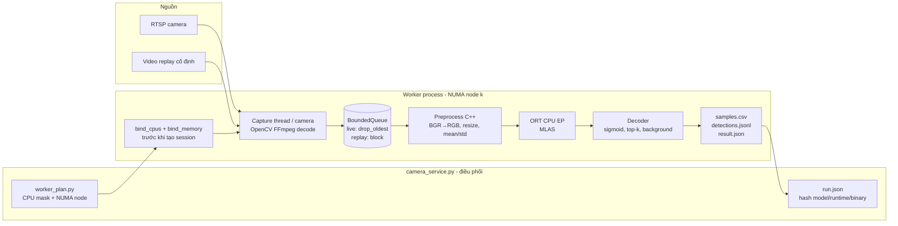
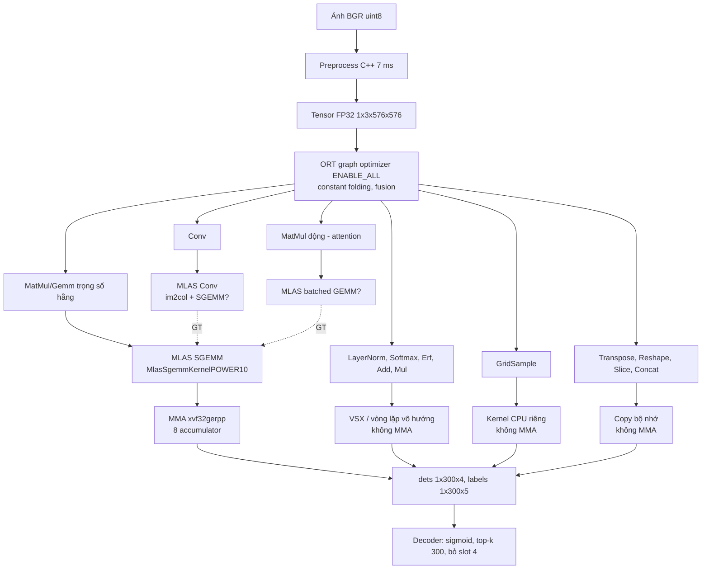
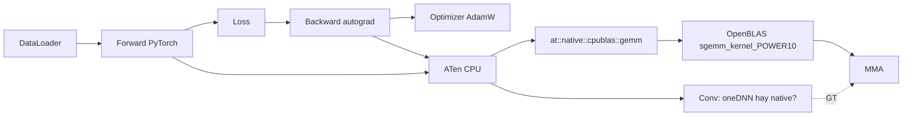
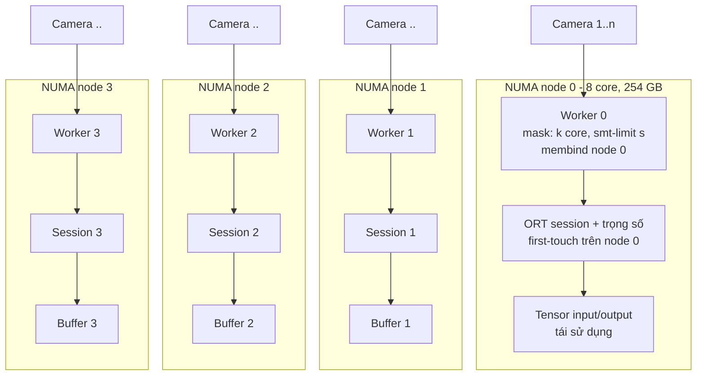
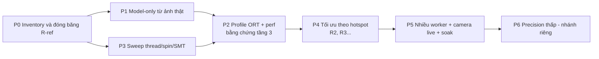

# Thiết kế kỹ thuật: RF-DETR 576 khai thác CPU MMA trên IBM Power11

Ngày lập: 27-11-2026. Phạm vi: suy luận RF-DETR Medium 576 FP32 trên CPU Power11 qua ONNX Runtime (ORT). Training và Spyre được mô tả như các nhánh riêng, không dùng để chứng minh hiệu quả CPU MMA.

Mỗi khẳng định trong tài liệu được gắn một trong ba nhãn sau:

- **[TL]** Đã xác minh từ tài liệu hoặc mã nguồn (có nguồn ở mục 10).
- **[ĐC]** Đã chạy thực tế trên server 10.0.1.70 (có số liệu hoặc output đã lưu).
- **[GT]** Giả thuyết, cần kiểm chứng. Không được dùng làm kết luận.

Mọi tối ưu đi theo một chuỗi cố định: **nút thắt → giả thuyết → thay đổi → correctness test → benchmark → giữ hoặc hoàn nguyên**.

---

## 0. Tóm tắt điều hành

| Câu hỏi | Trạng thái hiện tại |
|---|---|
| LPAR có expose MMA? | **Có [ĐC].** `AT_HWCAP2` có MMA, `lscpu` báo Power11, SMT8. |
| Backend ORT có kernel MMA? | **Có [ĐC].** ORT 1.27.0 (IBM wheel) chứa 336 lệnh MMA (họ `xvf32ger`, `xvi8ger4`, `xvbf16ger2`). |
| Kernel MMA có chạy trong ORT? | **Có, nhưng mới cho MatMul tổng hợp [ĐC].** Với MatMul 1024³ FP32 1 thread, `perf` cho `MlasSgemmKernelPOWER10` chiếm 84,7% mẫu, đạt 181,9 GFLOP/s. |
| Kernel MMA có chạy trong hot path RF-DETR? | **Chưa chứng minh.** Đây là việc ưu tiên số 1 (giai đoạn P2). |
| Hiệu năng hiện tại | Live 2,73 ± 0,02 FPS (3 lượt) [ĐC]. Replay cố định 3,14 ± 0,05 và 3,08 ± 0,07 FPS cho hai nhãn giống hệt (6 lượt xen kẽ) [ĐC]. |
| Ngưỡng phát hiện cải thiện | Khoảng 3,5% FPS với 3 lượt mỗi nhánh. Ước lượng từ phép đo nhiễu A/B, chưa phải kiểm định thống kê chính thức [ĐC]. |
| Có cần build ORT từ source để có MMA? | **Không, theo bằng chứng hiện có.** Wheel IBM đã dispatch kernel POWER10 lúc chạy. Chỉ build lại nếu profile cho thấy thiếu kernel cho operator quan trọng. |

Phép ước lượng số học ở mục 6.2 cho thấy phần GEMM tuyến tính của backbone chỉ khoảng 59 GFLOP mỗi frame. Nếu MLAS giữ được 182 GFLOP/s mỗi thread thì 4 thread cần cỡ 80 ms. Inference đo được lại là khoảng 336 ms. **Khoảng chênh này là giả thuyết trung tâm [GT]:** phần lớn thời gian có thể nằm ngoài kernel SGEMM MMA (attention MatMul động, Softmax, LayerNorm, GridSample, copy/transpose) hoặc ở hiệu quả threading. Chỉ profile mới phân xử được.

---

## 1. Kiến trúc tổng thể

### 1.1 Hạ tầng đã đọc được trên LPAR [ĐC]

| Thuộc tính | Giá trị đọc được | Nguồn |
|---|---|---|
| CPU | Power11, ppc64le, SMT8, 240 logical CPU | `lscpu` |
| Kiểu LPAR | Shared, Uncapped, Entitled Capacity 14,50 | `lparstat -i` |
| Virtual CPU | 30 online, tối đa 64 | `lparstat -i` |
| Shared pool | 15 physical CPU, Maximum Capacity of Pool 15,00 | `lparstat -i` |
| NUMA | 4 node, bộ nhớ 254 / 245 / 245 / 233 GB | `numactl --hardware` |
| CPU theo node | node 0: 0–7, 32–39, 64–71, …; node 1: 8–15, 40–47, 72–79, … | `numactl --hardware` |
| GCC hệ thống | 11.5.0 (Red Hat 11.5.0-14) | `gcc --version` |
| CMake | 3.31.8 | `cmake --version` |
| Spyre | 8 thiết bị trong `lspci`, bind `vfio-pci`, runtime chưa xác minh | `lspci -k` |

Hai hệ quả thiết kế:

1. **Ngân sách CPU thực là khoảng 15 core vật lý, không phải 240.** Pool chỉ có 15 physical CPU, nên 30 VCPU chia sẻ 15 core. Power10 Quick Start khuyên số VCPU không vượt số core trong shared pool và đặt entitlement gần mức sử dụng trung bình [TL, P10 QS – PowerVM Best Practices]. Cấu hình hiện tại (30 VCPU trên pool 15) vượt khuyến nghị đó. Đây là hạng mục cho quản trị viên PowerVM, không phải việc repo tự đổi.
2. **Một mô hình nên nằm gọn trong một NUMA node, và bộ nhớ cấp từ cùng node** [TL, SG24-8592 §5.2]. Mỗi node có 64 logical CPU, tức 8 core SMT8. Trên LPAR shared, việc này giảm nhảy node nhưng không đảm bảo core vật lý cố định, vì hypervisor vẫn dispatch VCPU. Có thể đọc điểm affinity bằng `lparnumascore` (powerpc-utils) [TL, P10 QS – Enterprise Linux].

### 1.2 Sơ đồ khối



Thành phần hiện có trong repo [ĐC, mã nguồn]:

- `core/src/camera_pipeline.cpp`: một capture thread và một queue cho mỗi camera, một consumer inference mỗi worker, chạy round-robin.
- `core/src/ort_session.cpp`: `intra_op=threads`, `inter_op=1`, `ORT_SEQUENTIAL`, `ORT_ENABLE_ALL`, `session.intra_op.allow_spinning=0`.
- `core/src/placement.cpp`: bind CPU và memory policy trước khi nạp model (lỗi EINVAL khi bind NUMA đã được sửa, có regression test).
- Timer inference đo đến khi `session.Run()` đồng bộ trả về, không chỉ đo lúc enqueue.

---

## 2. Đường thực thi xuống kernel MMA

### 2.1 Inference

Dữ liệu dưới đây đếm trực tiếp từ graph `rfdetr_medium_traffic_576.onnx` (SHA256 bắt đầu `7592fd8c808c3547`, opset 17, 1666 node, 30 039 234 tham số) [ĐC, đọc graph].

| Nhóm operator | Số node | Kích thước trọng số tiêu biểu | Ý nghĩa kiến trúc |
|---|---|---|---|
| MatMul với trọng số hằng | 119 | 384×384 (48), 384×1536 (12), 1536×384 (12), 256×256 (30), 256×2048 (4), 2048×256 (4) | Backbone ViT 12 block hidden 384 (q, k, v, proj và MLP), decoder 256, FFN 2048 |
| MatMul động (hai input là activation) | 32 | không có | Q·Kᵀ và attn·V của self-attention |
| Gemm | 4 | nhỏ | Head |
| Conv | 9 | 384×3×16×16 (patch embed), 128×128×3×3 (6), 1×1 (2) | Patch 16, tức 36×36 = 1296 token ở 576; projector đa tỉ lệ |
| LayerNormalization | 51 | | |
| Softmax | 20 | | Attention |
| Erf | 12 | | GELU trong MLP backbone |
| GridSample | 4 | | Deformable attention của decoder (4 lớp) |
| Transpose / Reshape / Slice / Concat | 125 / 137 / 67 / 28 | | Chuyển layout, chia window/head |



Trạng thái từng nhánh:

| Nhánh | Đường MMA phù hợp? | Trạng thái |
|---|---|---|
| MatMul trọng số hằng → SGEMM | Có. GEMM FP32 là dạng MMA hướng tới [TL, REDP-5612 ch.3–4] | Kernel POWER10 chạy thật trên MatMul tổng hợp [ĐC]. Trên RF-DETR: **[GT]**, cần P2. |
| Conv | Có thể, nếu MLAS hạ về SGEMM | **[GT].** Cần symbol của `perf` lúc Conv chạy. |
| MatMul động (attention) | Có thể, nếu MLAS dùng batched SGEMM không prepack | **[GT].** Đây là nghi vấn lớn vì shape phụ thuộc số token và window. |
| LayerNorm, Softmax, Erf, Add/Mul | Không. Đây là phép từng phần tử hoặc rút gọn, không phải tích ngoài | Chạy VSX hoặc vô hướng. Tối ưu bằng fusion hoặc VSX, không bằng MMA. |
| GridSample | Không | Kernel truy cập bộ nhớ ngẫu nhiên. |
| Transpose/Reshape/Concat | Không | Chi phí copy. Giảm bằng fusion hoặc layout. |

Ảnh hưởng của graph optimizer: ORT có thể gộp hoặc đổi operator khi `ORT_ENABLE_ALL`, ví dụ fusion LayerNorm hoặc GELU, hay MatMul+Add thành FusedMatMul/Gemm. Bảng hotspot vì vậy phải lấy từ **graph đã tối ưu** mà session lưu ra (`optimized_model` trong `benchmark.py`). Không lấy từ graph gốc ở trên. Graph gốc chỉ dùng để nhận diện kiến trúc.

### 2.2 Tích hợp kernel hoặc custom operator khi backend thiếu

Chỉ làm sau khi P2 chỉ ra một operator cụ thể vừa tốn thời gian vừa không đi qua kernel MMA hiệu quả:

1. **Custom operator ORT (C++).** Đăng ký một custom op domain riêng, thay node đích trong ONNX bằng script có kiểm hash. Kernel nằm trong một translation unit riêng biên dịch `-mcpu=power10 -mmma`, giống cách repo đang làm với `core/src/gemm_mma.cpp`. Dispatch lúc chạy theo `AT_HWCAP2 & PPC_FEATURE2_MMA`. Nếu không có MMA thì dùng một fallback tham chiếu có cùng kết quả số học trong ngưỡng.
2. **Không sửa MLAS tại chỗ** trừ khi có bản build ORT từ source riêng, có commit và hash (xem `docs/BUILD_ORT.md`).
3. **Kernel repo đã được viết lại theo REDP-5612 §4.1 nhưng chưa đo.** Bản cũ (4×4, một accumulator) đạt khoảng 33 GFLOP/s so với 182 của MLAS và 190 của OpenBLAS (torch), cùng 1 thread [ĐC]. Bản mới có tile 8×16, 8 accumulator, K chia khối 256 và panel căn 64 byte. Biên dịch bằng clang cho ppc64le: vòng lặp chính có 16 `xvf32gerpp` trên 12 lần nạp vector (tức 8 gerpp mỗi 6 lần nạp), không có spill hay `xxmfacc` trong vòng lặp. **Đo trên Power11 (1 thread, 1024³ FP32, 5 mẫu, [ĐC]):** 13,72–14,92 ms, tức khoảng 156 GFLOP/s (trung vị 13,76 ms), sai số tối đa 2,35e-5 so với oracle FP64. Bản cũ 4×4 là khoảng 33 GFLOP/s, nên bản mới nhanh khoảng 4,7 lần, và đạt khoảng 86% MLAS (182) và 82% OpenBLAS (190). Đường tham chiếu vô hướng cùng tile là 294,7 ms (7,3 GFLOP/s, một mẫu). Timer gồm cả pack A và copy output. **`ctest` (`core_tests`) qua 100% trên server [ĐC]**, với `compiled=true, exposed=true` nên nhánh MMA được chạy so với oracle FP64 trên các shape m ∈ {1…17}, n ∈ {1…33}, k ∈ {1…300} gồm đuôi tile và K vượt một khối 256. `objdump` trên object của GCC 11.5 cho **0 lệnh `lxvp`**: GCC không gộp các lần nạp thành lxvp, nên mỗi bước k dùng 6 lần nạp vector rời (đã nằm trong con số 156 GFLOP/s). Cải tiến còn lại là nạp cặp tường minh, chưa thử. **Chưa lượng hóa:** nhiễu đo trên LPAR shared (5 mẫu, một lượt). Clang không gộp các lần nạp thành `lxvp`; GCC 11.5 có gộp hay không phải kiểm bằng `objdump -d build/CMakeFiles/rfdetr_core.dir/core/src/gemm_mma.cpp.o | grep -c lxvp`. REDP-5612 §4.1 chỉ ra cách khắc phục: dùng cả 8 accumulator và tile 8×16 FP32, nạp cặp bằng `lxvp`, sao cho cứ 6 lần nạp vector thì có 8 lệnh `gerpp` [TL]. Kernel riêng chỉ đáng làm cho shape mà MLAS kém, ví dụ M nhỏ hoặc K lẻ.

### 2.3 Training (nhánh riêng)



- **Backend training độc lập với inference.** PyTorch 2.13.0 (IBM wheel) dùng OpenBLAS 0.3.32 đóng gói trong `torch.libs`. Trên `a @ a` 2048² 1 thread, `perf` cho `sgemm_kernel_POWER10` chiếm 67,7% mẫu, với call stack qua `at::native::cpublas::gemm` [ĐC]. Bằng chứng ORT/MLAS không áp dụng cho PyTorch, và ngược lại.
- SG24-8592 §5.5.2 cảnh báo có bản OpenBLAS trong wheel devpi được cấu hình kiến trúc Power9, khi đó "MMA kernels might not be compiled" [TL]. Bản torch đang dùng đã có symbol POWER10 thật trong `perf`, nhưng **mỗi wheel mới phải kiểm lại**.
- Conv và backward của Conv có thể đi qua oneDNN hoặc kernel native, chưa xác minh [GT]. Bằng chứng training phải là `perf` trên chính một bước train RF-DETR, không phải microbenchmark NumPy.
- Repo hiện đã bỏ training (theo quyết định của chủ dự án). Mục này chỉ là thiết kế để mở lại khi cần.

---

## 3. Worker, queue, buffer theo NUMA



Thứ tự khởi tạo trong worker [ĐC, mã nguồn]:

1. Đọc mask và node từ plan.
2. Kiểm tra mask nằm trong cpuset hiện có.
3. `bind_cpus`, sau đó `bind_memory(node)`. Nếu một trong hai lỗi thì worker thất bại, không tự hạ cấp.
4. Tạo ORT session. Trọng số và prepack được cấp phát sau khi bind, nên first-touch rơi vào node đúng.
5. Tạo buffer preprocess và tensor (tái sử dụng giữa các frame).
6. Khởi động capture thread và warmup.

Kiểm soát thread pool:

- **ORT intra-op:** đặt bằng số CPU trong mask. **Inter-op:** bằng 1 với `ORT_SEQUENTIAL`. Tài liệu ORT ghi rằng khi đặt số thread tường minh thì ORT không tự gán affinity [TL, ORT threading]. Repo đã bind ở mức process.
- **Capture/FFmpeg** chạy trên cùng mask. Thread của codec không bị `cv::setNumThreads(1)` khống chế hoàn toàn (xem `docs/CORE.md`). Khi sweep cần ghi số thread thực của process.
- **Spinning:** repo đặt `allow_spinning=0`, trong khi mặc định của ORT là 1 [TL, ORT threading]. Tắt spinning giảm chiếm CPU trên LPAR shared nhưng có thể làm tăng độ trễ đồng bộ giữa các thread. Đây là ứng viên R2 rẻ nhất (mục 6.4).
- **Không chồng mask** giữa các worker. Tổng thread của mọi worker không vượt khoảng 15 core vật lý của pool nếu tính theo core (mục 1.1).

Hai cấu hình đích được tối ưu riêng [TL, `docs/SYSTEM.md`]:

| Mục tiêu | Cấu hình khởi đầu | Biến được sweep |
|---|---|---|
| Latency thấp nhất (1 camera) | 1 worker, 1 node | thread 2/4/6/8, smt-limit 1/2/4 |
| Throughput tổng cao nhất | 1–4 worker, mỗi worker một node | thread mỗi worker, số worker, tổng không vượt ngân sách pool |

Queue: mỗi camera có `BoundedQueue` riêng. Live dùng `drop_oldest` và tùy chọn `max_frame_age_ms`. Replay dùng `block`, có `expected_frames` để kiểm đủ frame. Reconnect hữu hạn bằng `reconnect_attempts` và `reconnect_delay_ms` [ĐC, mã nguồn].

---

## 4. Ma trận phần mềm và build

| Lớp | Phiên bản đang dùng | Nguồn và cách cài | Bằng chứng |
|---|---|---|---|
| OS | RHEL 9.8, ppc64le | Có sẵn | [ĐC] |
| Python | 3.12 (venv `.venv-cpu` từ conda env `rfdetr-cpu`) | Không đụng Python hệ thống | [ĐC] |
| ORT Python | 1.27.0, IBM wheel, `CPUExecutionProvider` | Wheelhouse offline, `pip check` sạch | [ĐC] |
| ORT C++ SDK | Header từ NuGet 1.27.0 (`ORT_API_VERSION` 27) cộng `libonnxruntime.so.1.27.0` và `libprotobuf-lite` lấy từ wheel IBM, đặt tại `/home/models/stack/onnxruntime-1.27.0` | Tự lắp ráp | [ĐC]. Phải ghi SHA256 của `.so` vào `run.json` (đã có). |
| MLAS | Theo wheel ORT 1.27.0 | Không build lại | `MlasSgemmKernelPOWER10` chạy thật trên MatMul tổng hợp [ĐC] |
| OpenCV | 4.13 (conda-forge, headless, FFmpeg) tại `/home/models/stack/opencv4` | Prefix riêng | [ĐC]. `cv2` 5.0.0 trong venv **không có FFmpeg**, không đọc được RTSP [ĐC]. |
| Compiler cho core | GCC 11.5.0 hệ thống, kernel 5.14.0-687.57.1.el9_8 | Có sẵn | `-mcpu=power10 -mmma` biên dịch được MMA builtin; `-mcpu=power11` bị từ chối [ĐC] |
| Link camera | `LDFLAGS="-Wl,-rpath,$C -Wl,--no-as-needed $C/libstdc++.so.6"` | Vì OpenCV conda cần `GLIBCXX_3.4.32` | [ĐC] |
| CMake | 3.31.8 | Có sẵn | [ĐC] |
| PyTorch (training/export) | 2.13.0 IBM wheel, OpenBLAS 0.3.32 trong `torch.libs` | venv riêng | `sgemm_kernel_POWER10` chạy thật [ĐC] |
| RF-DETR | Export ONNX làm trên máy dev x86 | venv export riêng | Phiên bản gói chưa ghi vào manifest. **Thiếu.** |

Quy tắc build:

- `-mcpu=power10` chỉ áp cho translation unit chứa MMA, không áp toàn binary [TL, P10 QS – GCC: object `-mcpu=power10` không chạy trên Power9 trở về trước]. Power10 và Power11 cùng ISA 3.1, và kernel của OpenBLAS được đặt tên Power10 theo ISA chứ không theo thế hệ chip [TL, SG24-8592 §5.5].
- `-mcpu=power11` được SG24-8592 §5.3.2 nhắc đến, nhưng **GCC 11.5.0 trên server từ chối cờ này [ĐC]**. Dùng `-mcpu=power10` (cộng `-mmma` cho đúng translation unit MMA); repo đang làm đúng như vậy.
- GCC ≥ 10 và LLVM ≥ 12 hỗ trợ MMA builtin [TL, REDP-5612 ch.5; P10 QS]. P10 QS khuyên GCC 11.2 trở lên để có đủ tính năng ISA 3.1. GCC 11.5 thỏa điều kiện này.
- Tên builtin cần chú ý: REDP-5612 dùng `__builtin_mma_assemble_acc`, còn trang Open XL 17.1.1 liệt kê `__builtin_mma_build_acc` [TL]. Mã repo chỉ dùng `xxsetaccz`, `xvf32gerpp`, `disassemble_acc`, là các tên có mặt ở cả hai nguồn.
- Trước khi dùng cờ nào, chạy `bash scripts/probe_mma_toolchain.sh` trên server (chỉ đọc, biên dịch chương trình nhỏ trong thư mục tạm). Script kiểm: builtin MMA biên dịch được với `-mcpu=power10 -mmma`; compiler có nhận `-mcpu=power11` không; và `AT_HWCAP2` có `PPC_FEATURE2_MMA`/`ARCH_3_1`. Đây là cách trả lời mục "GCC 11.5 có hỗ trợ `-mcpu=power11` không" bằng thực nghiệm thay vì tin một trang tổng quan.
- Mỗi build ghi `build-manifest.json` (hash nguồn và sản phẩm), `configure.log`, `build.log`, `ctest.log` (`scripts/build_core.sh`).
- **Không thêm cờ ORT kiểu `--enable_mma` hay `--use_openblas`.** Không tài liệu chính thức nào nêu các cờ này. MLAS tự probe compiler và tự dispatch theo HWCAP [TL, `docs/SUPPORT.md`, `docs/BUILD_ORT.md`].

---

## 5. Quy trình chứng minh MMA thực chạy

### 5.1 Ba tầng bằng chứng

| Tầng | Câu hỏi | Bằng chứng chấp nhận | Trạng thái |
|---|---|---|---|
| 1. LPAR | CPU có expose MMA cho process? | `AT_HWCAP2` có `PPC_FEATURE2_MMA` và `ARCH_3_1`; `rfdetr_gemm --capability` báo `exposed: true` | **Đạt [ĐC].** `AT_HWCAP2=0xbef60000`: mma=1, arch_3_1=1 (đọc lại bằng `probe_mma_toolchain.sh`) |
| 2. Binary | Thư viện đang được load có kernel MMA và có đường dispatch? | `objdump -d` trên đúng file `.so` mà process load (hash khớp `run.json`) có lệnh `xvf32ger*`; symbol `MlasSgemmKernelPOWER10` tồn tại | **Đạt [ĐC].** 336 lệnh MMA. |
| 3. Hot path RF-DETR | Khi RF-DETR chạy, CPU có thực thi kernel đó ở các operator ma trận? | (a) `perf record -g` trên process `rfdetr_camera` (hoặc model-only) đang chạy RF-DETR, symbol MMA chiếm tỉ trọng đáng kể; (b) call stack nối về node MatMul/Conv của ORT; (c) ORT profile cho thấy các node đó chiếm phần lớn thời gian | **Chưa có** |

Các dấu hiệu sau **không đủ** cho tầng 3: tên Power11, `CPUExecutionProvider`, binary chứa lệnh MMA, OpenBLAS đã cài, FPS tăng, hoặc `strings libopenblas.so | grep power10` (cách kiểm liên kết trong SG24-8592 §5.5.1) [TL].

### 5.2 Lệnh thu bằng chứng tầng 3

Lượt profile phải tách khỏi lượt đo KPI.

```bash
cd /root/Workspaces/IBM-Power-11-
# (a) ORT operator profile: bật profile trong một config replay RIÊNG
python - <<'E'
import json
c = json.load(open('configs/replay-rfdetr-a-local.json'))
c['session']['profile'] = 1
json.dump(c, open('configs/replay-rfdetr-profile-local.json', 'w'), indent=2)
E
python scripts/camera_service.py --config configs/replay-rfdetr-profile-local.json \
  --output runs/p2-ortprofile
# profile_path nằm trong result.json của worker
P=$(python -c "import json,glob;print(json.load(open(glob.glob('runs/p2-ortprofile/worker-*/result.json')[0]))['profile_path'])")
python scripts/profile_ops.py "$P" --output runs/p2-ortprofile/ops.csv --shapes runs/p2-ortprofile/shapes.json

# (b) perf trên chính process RF-DETR, terminal thứ hai trong lúc replay đang chạy
PID=$(pgrep -n rfdetr_camera)
perf record -F 999 -g -p "$PID" -o runs/p2-perf.data -- sleep 30
perf report -i runs/p2-perf.data --stdio --no-children --sort dso,symbol | head -60 > runs/p2-perf-top.txt
perf report -i runs/p2-perf.data --stdio --children --symbol-filter=Mlas | head -120 > runs/p2-perf-mlas.txt
```

- Chạy (b) trên một lượt replay **không bật profile ORT**, vì profile ORT làm thay đổi thời gian.
- Tên PMU event phải lấy từ `perf list` trên đúng server. Không tự đặt tên event đếm lệnh MMA. Nếu không có event phù hợp, tầng 3 dựa vào symbol và call stack.
- Lưu `perf` version, kernel và quyền (`/proc/sys/kernel/perf_event_paranoid`) cùng output.

### 5.3 Quy kết lợi ích cho MMA

MLAS không có công tắc tắt MMA được tài liệu hóa, và tài liệu này không bịa ra công tắc đó. Vì vậy không có phép A/B "MMA bật/tắt" trực tiếp trên ORT. Phần lợi ích của MMA được quy kết bằng ba cách:

1. Tỉ trọng thời gian của các symbol MMA trong `perf` trên RF-DETR (tầng 3).
2. Microbenchmark trên **shape thật** của RF-DETR (lấy từ `shapes.json`), so kernel MMA với đường tham chiếu VSX hoặc vô hướng của repo (`gemm_sweep.py --backends reference mma`). Đây là so sánh ở mức kernel, ghi rõ `--comparison kernel` trong `compare_runs.py`.
3. Khi đổi cả stack (compiler, backend, NUMA), báo là **cải thiện toàn stack**, không quy hết cho MMA.

Có thể gọi R0 là "MMA off" chỉ khi có một bản build đã chứng minh không chạy kernel MMA. Hiện tại không có bản như vậy.

Dùng `scripts/mma_evidence.py --workload inference` để kiểm tính nhất quán của hồ sơ bằng chứng (hash, trace đính kèm) sau khi đã có output thật.

---

## 6. Hotspot và công việc tối ưu C++/MMA

### 6.1 Bảng hotspot (khung, điền sau P2)

| # | Operator/node | Tỉ trọng thời gian | Shape / M·N·K | Dtype / layout / stride | Kernel thực chạy | Bằng chứng MMA | Hướng tối ưu |
|---|---|---|---|---|---|---|---|
| 1 | | | | FP32 | | | |
| … | | | | | | | |
| 10 | | | | | | | |

Nguồn điền bảng: `ops.csv` (tỉ trọng, shape), `shapes.json` (M/N/K cụ thể), `p2-perf-*.txt` (kernel và symbol). Mỗi dòng ghi rõ cột nào là [ĐC] và cột nào là [GT].

### 6.2 Ước lượng khối lượng tính toán [GT, số học từ graph]

Phép tính này là ước lượng để định hướng profile, không phải số đo.

- **Backbone, mỗi block:** 4 phép chiếu 384×384 và MLP 384↔1536 trên T token. Số MAC bằng T·384·(4·384 + 2·1536) = T·384·4608. Với T ≈ 1297 (1296 patch và có thể thêm token đặc biệt), mỗi block khoảng 2,3·10⁹ MAC. 12 block cho khoảng 27,5 GMAC, tức 55 GFLOP.
- **Projector Conv, patch embed, decoder:** thêm vài GMAC.
- **Attention động:** nếu attention là toàn cục thì Q·Kᵀ và attn·V cộng lại khoảng 2·T²·384 MAC mỗi block, tức tới khoảng 31 GFLOP cho 12 block. RF-DETR dùng windowed attention ở một số block, nên con số thật nhỏ hơn. Cần shape thật từ profile.

Từ đó:

- Ở 182 GFLOP/s mỗi thread (MLAS, MatMul 1024³) [ĐC], phần GEMM tuyến tính tốn cỡ 0,3 giây trên 1 thread, hay cỡ 80 ms trên 4 thread nếu scale tuyến tính.
- Inference đo được trung bình 336–351 ms trên 4 thread [ĐC].
- **Giả thuyết cần phân xử bằng P2:** (H1) attention MatMul động không đi qua đường SGEMM có prepack, hoặc có M/N nhỏ làm hiệu suất thấp; (H2) phép từng phần tử (Softmax trên 6 head × T × T, LayerNorm, Erf) và copy (Transpose/Reshape) chiếm phần lớn; (H3) scale 4 thread kém trên LPAR shared, hoặc `allow_spinning=0` làm tăng chi phí đồng bộ; (H4) GridSample hoặc decoder tốn nhiều hơn dự kiến; (H5) **thread capture/decode nằm cùng CPU mask với thread inference** ([camera_pipeline.cpp](../core/src/camera_pipeline.cpp) tạo capture thread trong cùng process đã bind). Capture trung bình khoảng 40 ms mỗi frame được giải mã trên chính 4 CPU đó, nên cạnh tranh với 4 thread ORT. Chưa đo ảnh hưởng.

### 6.2b Kết quả P2 đợt 1 (profile ORT và `perf` trên `rfdetr_camera`, [ĐC])

**Nguồn và giới hạn dữ liệu.** (1) ORT profile lấy từ `ops.csv` do `profile_ops.py` tạo; file profile gốc mang dấu thời gian 2026-11-26 22:23:31, tức đến từ lượt profile đã chạy trước đó. Lệnh `camera_service.py` trong lượt này báo `FileExistsError` vì thư mục `runs/p2-ortprofile` đã tồn tại, nên `ops.csv` **không** phải của lượt mới. Cùng model, cùng ORT, nhưng chạy bằng binary cũ `build-camera`. Mỗi node có 430 lần gọi (400 frame cộng 30 warmup), tổng thời gian có gồm warmup, và thời gian có thể chồng nhau giữa các node. Chỉ 25 node đầu được xem, nên chưa có tỉ trọng theo toàn graph. (2) `perf` chạy trên `rfdetr_camera` của `build-power-camera`, replay clip 400 frame, 55 672 mẫu `cycles:P` trong 30 giây, không bật profile ORT. Chỉ mục đầu của báo cáo được xem.

**Bằng chứng MMA tầng 3: đạt cho đường Gemm [ĐC].** Symbol đứng đầu là `MlasSgemmKernelPOWER10` trong `libonnxruntime.so.1.27.0`, chiếm **46,36% chu kỳ của cả process**. Call stack nối trọn từ code của repo đến kernel: `main` → `run_camera_worker` → `RfdetrPath::infer` → `OrtSession::run` → `InferenceSession::Run` → `ExecuteGraph` → `onnxruntime::Gemm<float>::Compute` → `MlasGemmBatch` → `MlasSgemmThreaded` → `MlasSgemmPackedOperation` → `MlasSgemmKernelPOWER10`. `MlasSgemmPackedOperation` là đường B đã prepack (trọng số), chiếm 30,9% trong số đó. **Chưa có stack cho đường `MatMul` động (attention)**: phần báo cáo bị cắt trước khi tới đó.

**Cấu trúc graph (đính chính mục 2.1 và 6.2).** Attention là **toàn cục**: 1300 token, 6 head, head dim 64 (không phải attention theo cửa sổ). Tensor attention là `[1, 6, 1300, 1300]`.

| Node (một layer, 12 layer) | ms/lần gọi | GFLOP/lần | GFLOP/s trên 4 thread | % của 4×182 |
|---|---|---|---|---|
| `attention MatMul_1` (attn·V), `[6,1300,1300]×[6,1300,64]` | 4,2–4,3 | 1,30 | 301–307 | 41–42% |
| `fc1` Gemm `[1300,384]×[384,1536]` | 3,8–4,05 | 1,53 | 379–386 | 52–53% |
| `fc2` Gemm `[1300,1536]×[1536,384]` | 3,4–3,5 | 1,53 | 443–446 | 61% |
| `FusedMatMul` QKᵀ `[6,1300,64]×[6,64,1300]` | 3,3–3,35 | 1,30 | 387–391 | 53–54% |
| `Softmax` `[1,6,1300,1300]` | 3,7–3,8 | | 2,7 G phần tử/s | không phải MMA |

Ước lượng khối lượng: tuyến tính khoảng 55 GFLOP, attention khoảng 31 GFLOP, tổng khoảng 86 GFLOP mỗi frame. Với 336 ms inference, tốc độ trung bình khoảng **257 GFLOP/s trên 4 thread**, bằng khoảng 35% mức 4×182 nếu scale tuyến tính hoàn hảo. Năm loại node trong bảng cộng lại khoảng 18,7 ms mỗi layer, nhân 12 layer khoảng 224 ms, tức khoảng hai phần ba thời gian inference.

**Kết luận chưa đầy đủ, và những giả thuyết bị ảnh hưởng.**
- H1 (attention MatMul động không đi qua SGEMM hiệu quả): **ủng hộ một phần.** `attn·V` đạt 41–42% mức tuyến tính, thấp nhất trong các phép nhân. Chưa biết vì sao: shape `[1300×1300]×[1300×64]` với N=64 hẹp, hay chi phí nhân theo batch 6 head.
- H2 (phép từng phần tử chiếm phần lớn): Softmax riêng đã mất khoảng 3,7 ms × 12 = 45 ms, khoảng 13% inference, nhưng đây không phải kernel MMA.
- H3 (hiệu quả threading): **ủng hộ.** Mọi phép nhân chỉ đạt 41–61% mức scale tuyến tính 4 thread. Khoảng trống này có thể do đồng bộ thread, băng thông hoặc nhiễu LPAR. Sweep thread và `allow_spinning` là hai thí nghiệm trực tiếp.
- Ước lượng "khoảng 80 ms" ở mục 0 và 6.2 là mức tối đa lý thuyết với 100% scale, không phải mức đạt được. Cần hiểu như vậy khi so với 336 ms.

**Còn thiếu để lập bảng hotspot đầy đủ:** tổng thời gian theo loại operator trên toàn graph (không chỉ 25 node), danh sách symbol đứng sau `MlasSgemmKernelPOWER10` trong `perf`, và stack của đường `MatMul` động.

### 6.2c Phân bổ thời gian theo toàn graph và theo `perf` ([ĐC])

**Theo ORT profile (tổng thời gian node, 316,5 ms/frame, có warmup, có thể chồng nhau; từ lượt profile cũ, binary `build-camera`):**

| Operator | Số node | ms/frame | Tỉ trọng |
|---|---|---|---|
| Gemm | 122 | 142,9 | 45,1% |
| LayerNormalization | 38 | 53,1 | **16,8%** |
| Softmax | 20 | 22,3 | 7,0% |
| Gelu | 12 | 21,8 | 6,9% |
| MatMul (động) | 16 | 21,3 | 6,7% |
| FusedMatMul | 16 | 18,8 | 5,9% |
| Conv | 9 | 11,9 | 3,8% |
| Transpose | 114 | 9,0 | 2,8% |
| Còn lại (Add, Mul, Reshape, GridSample, SkipLayerNorm, Slice) | | 11,8 | 3,7% |

**Theo `perf` (chu kỳ của cả process `rfdetr_camera`, lượt replay không bật profile ORT, 55 672 mẫu):**

| Nhóm | % chu kỳ | MMA? |
|---|---|---|
| `MlasSgemmKernelPOWER10` | 46,36 | **Có** (đã xác minh tầng 3) |
| `L_Rows8` | 7,10 | Nhiều khả năng là nhãn nội bộ của cùng kernel assembly (tên có dạng nhãn; trong lượt MatMul tổng hợp trước đó nó đứng ngay sau kernel). **[GT]** chưa xác nhận bằng `perf annotate` |
| SGEMM phụ (`CopyPackB`, `PackedOperation`, `Operation`) | 1,36 | Chuẩn bị dữ liệu |
| `GemmBroadcastBias` | 1,25 | Không |
| **LayerNorm** (`ComputeJob<float,float,void>` 15,85, contrib `ComputeJob` 0,25, batch parallel 0,29) | **16,39** | **Không** |
| Gelu/Erf (`MlasErfKernel` 5,51, `MlasGeluErfKernel` 1,43) | 6,94 | Không |
| Softmax (`SumExp` 4,90, `ReduceMaximum` 0,97, `Output` 0,50) | 6,37 | Không |
| Thread pool `RunInParallel` | 3,49 | Đồng bộ thread |
| Transpose (`MlasTransposeThreaded` 1,19, `StridedCopy` 0,65) | 1,84 | Không |
| GridSample bilinear | 1,21 | Không |
| `Preprocessor::run`, `memcpy`, Logistic, Add/Mul | 3,13 | Không |
| `libavcodec` (decode MJPG) | khoảng 0,2 | Không (replay MJPG rẻ; H.264 live khác) |

Hai nguồn khớp nhau: Gemm, MatMul và FusedMatMul chiếm 57,7% thời gian node; SGEMM chiếm khoảng 55–57% chu kỳ. LayerNorm khớp 16,8% so với 16,4%; Softmax 7,0% so với 6,4%; Gelu 6,9% so với 6,9%.

**Kết luận từ số đo, không phải dự đoán.**
1. Kernel MMA là khoảng 55% chu kỳ. **Khoảng 40% còn lại không thuộc đường MMA**, và LayerNorm là mục không-MMA lớn nhất (khoảng 16%), lớn hơn cả Softmax và Gelu cộng lại một chút.
2. Đồng bộ thread (RunInParallel, 3,5%) không lớn. Khoảng trống 41–61% so với scale tuyến tính (mục 6.2b) vì vậy nhiều khả năng nằm ở chỗ khác: mất cân bằng chia việc giữa các thread, băng thông bộ nhớ hoặc nhiễu LPAR. **Chưa đo.**
3. Giới hạn Amdahl với số đo này: kernel SGEMM nhanh thêm 20% chỉ giảm tổng thời gian khoảng 11%. Nếu LayerNorm nhanh gấp 5 lần thì giảm khoảng 13%. Hai thay đổi này cho lợi ích cùng cỡ.
4. Nguyên nhân LayerNorm chậm chưa biết: mã nguồn ORT trên GitHub trả 404 nên chưa đọc được `layer_norm_impl`. Không suy đoán cơ chế.
5. Ba giả thuyết cần xét lại: H2 (phép từng phần tử đáng kể) **được ủng hộ**; H1 (attention MatMul động không đi qua SGEMM) **không bị bác**: có `MatMul`/`FusedMatMul` 12,6% thời gian node nhưng stack của chúng chưa thấy; H3 (đồng bộ thread) **bị yếu đi** vì chỉ 3,5%.

### 6.2d Kết quả quét số thread P3 ([ĐC], `runs/ab-threads1`)

Replay clip cố định 400 frame, binary `build-power-camera`, 1 worker, NUMA node 0, `smt-limit 1`, 12 lượt xen kẽ (T4,T6,T8,T2,T2,T8,T6,T4,T4,T6,T8,T2), 3 lượt mỗi nhánh, mỗi lượt 400 mẫu, `allow_spinning=0`, `capture_cpus` không dùng. Trung bình ± độ lệch chuẩn của quần thể (n=3).

| Thread | FPS | Inference p50 (ms) | p95 (ms) | p99 (ms) |
|---|---|---|---|---|
| 2 | 2,39 ± 0,07 | 401,1 ± 1,7 | 455,1 ± 66,4 | 522,6 ± 149,8 |
| 4 | 3,00 ± 0,02 | 305,3 ± 9,9 | 472,7 ± 19,5 | 523,0 ± 14,1 |
| 6 | 2,99 ± 0,05 | 310,7 ± 4,1 | 398,8 ± 8,0 | 454,4 ± 9,4 |
| 8 | 3,17 ± 0,09 | 292,6 ± 5,8 | 394,6 ± 21,3 | 435,6 ± 18,0 |

Đọc theo quy tắc đã đặt (chênh FPS cần lớn hơn khoảng 3,5% và p95 không xấu đi vượt nhiễu):
- **2 thread chậm hơn 4 thread khoảng 20%**: vượt ngưỡng nhiễu rõ ràng.
- **6 thread không khác 4 thread về FPS** (−0,3%) nhưng p95 thấp hơn rõ (399 so với 473 ms, chênh khoảng 74 ms với độ lệch 8 và 20).
- **8 thread nhanh hơn 4 thread khoảng 5,7%** (3,17 so với 3,00), p95 thấp hơn (395 so với 473 ms). Vượt ngưỡng 3,5% nhưng ở mức biên (khoảng 2,6 lần sai số chuẩn của hiệu, chỉ 3 lượt).
- **Scale rất kém:** 2→4 thread chỉ nhanh 1,26 lần, 4→8 thread chỉ 1,06 lần. Trong đó gấp đôi thread chỉ cho lợi ích nhỏ, nên throughput tổng nên tăng bằng nhiều worker thay vì nhiều thread một worker.
- **Không so sánh tuyệt đối giữa các phiên.** T4 ở đây là 3,00 FPS, trong khi phép so binary chạy trước đó cho 3,15–3,22 FPS cùng cấu hình. Lệch khoảng 5–7% giữa hai phiên cách nhau khoảng một giờ trên LPAR shared. Chỉ so sánh trong cùng một phiên xen kẽ.
- Chưa biết nguyên nhân scale kém. Các giả thuyết cần phân xử: phần không song song hóa được trong ORT (một số operator chạy trên thread chính), chia việc không đều giữa các thread, băng thông bộ nhớ, hoặc nhiễu LPAR. Một mô hình Amdahl hai tham số khớp ba điểm này cho kết quả ngoại suy về 1 thread mâu thuẫn với tốc độ GEMM đã đo, nên **không** dùng mô hình đó để suy phần trăm.

### 6.2e Chia việc giữa các thread ([ĐC], `perf report --sort pid` trên `runs/p2-perf.data`)

Chu kỳ theo thread của process `rfdetr_camera` (4 thread, replay, 30 giây):

| Thread | % chu kỳ của process |
|---|---|
| 1562328 (thread chính, gọi `Run()`) | **43,81** |
| 1562331 | 21,04 |
| 1562330 | 19,54 |
| 1562329 | 14,66 |
| 4 thread capture/decode | 0,79 + 0,06 + 0,06 + 0,04 |

Bốn thread tính toán cộng 99,05%. Chia đều sẽ là khoảng 24,8% mỗi thread. **Thread chính dùng gấp 2,1 đến 3,0 lần chu kỳ của ba thread còn lại**, và thread kém nhất chỉ dùng 14,7%.

Suy luận (giả định, chưa đo): nếu thread chính luôn bận (nó là thread gọi `Run()` và tham gia mọi phần song song), thì ba thread còn lại bận khoảng 48%, 45% và 33% so với nó; trung bình chỉ khoảng 2,3 trên 4 core được dùng, tức khoảng 57%. Con số này khớp với hiệu quả scale 41–61% đã thấy ở mục 6.2b và với việc quét thread chỉ cải thiện nhỏ (mục 6.2d). Hai thread capture dùng dưới 1% chu kỳ trong replay MJPG nên H5 (`capture_cpus`) gần như không có gì để cải thiện ở replay; chỉ có thể thấy trên live H.264.

**Thread chính làm gì khác thread phụ? ([ĐC], `perf script -F tid,ip,sym`, phần trăm trong chính thread.)** Cả bốn thread tính toán có cùng một cấu hình symbol: `MlasSgemmKernelPOWER10` 44–53%, LayerNorm `ComputeJob` 16,0–17,7%, `L_Rows8` 6,6–7,8%, `MlasErfKernel` 5,3–7,0%, `MlasComputeSumExpF32Kernel` 4,8–5,7%. Không có operator nào chạy **chỉ** trên thread chính. Khác biệt duy nhất của thread chính là phần điều phối: `ThreadPool::RunInParallel` 6,6% (không nằm trong 7 symbol đầu của ba thread phụ) và `GemmBroadcastBias` 2,7%, nên tỉ lệ SGEMM trong thread chính thấp hơn (44% so với 52–53%).

Đổi sang chu kỳ tuyệt đối (tổng thread nhân phần trăm): thread chính thực hiện khoảng 40% tổng chu kỳ SGEMM và khoảng 44% tổng chu kỳ LayerNorm, so với khoảng 16–22% cho mỗi thread phụ. Tức **thread chính làm gần gấp đôi việc của mỗi thread phụ trong cùng loại operator**, chứ không phải gánh một operator riêng. LayerNorm cũng được chia cho cả bốn thread, nên LayerNorm không phải là phần chạy đơn thread.

Giả thuyết giải thích (chưa kiểm chứng): với `allow_spinning=0`, các thread phụ ngủ giữa các vùng song song và đánh thức chậm, nên thread chính (đã chạy sẵn) nhận phần lớn khối việc trước khi thread phụ vào; `RunInParallel` 6,6% trên thread chính là chi phí điều phối. Phép thử trực tiếp: A/B `allow_spinning` 0 và 1 ở 4 thread, rồi đo lại phân bố chu kỳ theo thread. Nếu `allow_spinning=1` làm phân bố đều hơn và tăng FPS, giả thuyết được ủng hộ; cái giá là các thread phụ quay vòng chiếm CPU khi nhàn rỗi, đáng kể trên LPAR shared.

### 6.2f A/B `allow_spinning` 0 và 1 ([ĐC], `runs/ab-spin1`)

Replay clip 400 frame, binary `build-power-camera`, 1 worker, 4 thread, node 0, 6 lượt xen kẽ (S0,S1,S1,S0,S0,S1), mỗi lượt 400 mẫu, load average 7,3–8,6.

| | FPS | Inference p50 (ms) | p95 (ms) | p99 (ms) |
|---|---|---|---|---|
| `allow_spinning=0` (S0) | 2,94 ± 0,00 | 320,9 ± 2,5 | 466,5 ± 9,6 | 522,5 ± 21,6 |
| `allow_spinning=1` (S1) | **4,07 ± 0,32** | **241,9 ± 32,9** | **244,9 ± 32,6** | **259,5 ± 31,0** |
| Thay đổi | **+38%** | −25% | **−48%** | −50% |

FPS từng lượt S1: 4,25 / 3,62 / 4,34 (suy ra lượt 02 từ trung bình); S0: 2,94 ba lần. Chênh lệch vượt xa ngưỡng nhiễu đã đo (khoảng 3,5%) và vượt cả khoảng dao động giữa các lượt S1.

**Hai đặc điểm đáng chú ý.**
1. **Đuôi độ trễ biến mất.** Với S0, p95 cao hơn p50 khoảng 146 ms. Với S1, p95 chỉ cao hơn p50 khoảng 2,5–3,3 ms trong từng lượt (lượt 03: 288,4 và 290,9; lượt 06: 216,6 và 219,9). Độ trễ mỗi frame gần như hằng số trong một lượt.
2. **Độ trễ khác nhau mạnh giữa các lượt S1** (p50 khoảng 217, 288 và giá trị thứ ba suy ra thấp hơn): chưa biết nguyên nhân, nhiều khả năng liên quan đến CPU vật lý mà hypervisor gán hoặc tải của các phân vùng khác. Chưa kiểm chứng.

**Cái giá CPU đo được một phần [ĐC]:** `top -H` giữa lượt chạy replay với `allow_spinning=1` cho 4 thread tính toán lần lượt 99,9%, 93,8%, 93,8%, 93,8% CPU, TIME+ khoảng 15,6–15,95 giây sau khoảng 16 giây chạy, tức **cả 4 core bị chiếm gần hết suốt thời gian xử lý** (thread capture 6,2%). Ghi chú: thời gian quay vòng chờ cũng được tính là bận, nên 94–100% không có nghĩa là toàn bộ là công việc hữu ích. **Chưa có số đo tương ứng cho `allow_spinning=0`.** Suy từ phân bố chu kỳ của `perf` (mục 6.2e, giả định thread chính luôn bận) thì khi tắt spinning khoảng 2,3 trên 4 core hoạt động; đó là suy luận, không phải số đo. Nếu cả hai con số đúng thì CPU tiêu thụ cho mỗi frame tăng khoảng 19% (khoảng 0,78 so với 0,93 core-giây mỗi frame) để đổi lấy +38% FPS của một worker. **Hệ quả cần kiểm chứng:** khi nhiều worker chạy đồng thời và bị giới hạn bởi số core (pool khoảng 15 core), tổng throughput có thể không tăng, thậm chí giảm; spinning có lợi nhất cho độ trễ của một luồng đơn.
 Trên LPAR shared uncapped (entitlement 14,5, pool 15 core) đó là CPU lấy khỏi các phân vùng khác. Chưa thấy ảnh hưởng này trong số đo, và phép đo chạy khi không có tải nào khác của ta.

**Correctness đã kiểm [ĐC]:** `compare_detections.py` giữa `01-S0` và `02-S1`: 400 frame so sánh, 400 frame khớp hoàn toàn, 5765 detection ghép được, `only_reference=0`, `only_candidate=0`, IoU nhỏ nhất 1,0, chênh score lớn nhất 0,0. Đầu ra giống hệt từng bit ở mức detection sau decode (chưa so tensor thô). **Chưa kiểm:** (b) cơ chế (phân bố chu kỳ theo thread với `allow_spinning=1`); (c) trên live RTSP với `capture_cpus`; (d) số thread tối ưu khi bật spinning (kết quả sweep 2/4/6/8 ở mục 6.2d là với spinning tắt).

### 6.2g Hai worker đồng thời, `allow_spinning` 0 và 1 ([ĐC], `runs/ab-multi1`)

Replay clip 400 frame, mỗi worker một camera (hai camera cùng clip), mỗi worker 4 thread trên một NUMA node riêng (node 0 và node 1), 6 lượt xen kẽ (M0,M1,M1,M0,M0,M1), mỗi lượt 800 mẫu. FPS là tổng throughput của hai worker (`throughput_active_fps`, tính trên cửa sổ từ lúc worker đầu bắt đầu đến lúc worker cuối kết thúc). Load average trong lúc chạy 4,4 đến 14,6.

| | Tổng FPS | Inference p50 (ms) | p95 (ms) | p99 (ms) |
|---|---|---|---|---|
| `allow_spinning=0` (M0) | 5,10 ± 0,14 | 398,1 ± 5,0 | 477,5 ± 6,3 | 522,7 ± 10,8 |
| `allow_spinning=1` (M1) | **8,45 ± 0,09** | **220,1 ± 1,5** | **235,2 ± 14,0** | **250,7 ± 16,8** |
| Thay đổi | **+66%** | −45% | −51% | −52% |

- **Spinning vẫn có lợi rõ rệt với 2 worker (8 thread quay vòng):** vượt xa nhiễu (độ lệch dưới 3% ở cả hai nhánh). Giả thuyết "spinning có thể làm hỏng throughput khi nhiều worker tranh core" **không đúng ở 2 worker** trên LPAR này.
- **Scale từ 1 lên 2 worker:** tắt spinning 5,10 so với 2,94 FPS của một worker (khoảng 1,73 lần, hiệu suất khoảng 87%); bật spinning 8,45 so với 4,07 FPS của một worker (khoảng 2,08 lần). Con số 2,08 vượt 2 do một worker bật spinning đo trước đó dao động mạnh (3,62 đến 4,34) và đo ở phiên khác; không nên đọc là siêu tuyến tính. Cùng phiên thì mỗi worker đạt khoảng 4,2 FPS.
- **Chưa biết điểm bão hòa.** 2 worker × 4 thread = 8 thread quay vòng, chưa chạm giới hạn pool khoảng 15 core. Với 4 worker (16 thread) vượt pool.
- **Cái giá:** load average đạt 14,6 khi spinning, trên LPAR shared uncapped (entitlement 14,5). Tác động lên các phân vùng khác chưa đo.

### 6.2h Bốn worker đồng thời: điểm bão hòa ([ĐC], `runs/ab-multi4`)

Replay clip 400 frame, bốn worker × 4 thread, mỗi worker một NUMA node (0 đến 3) và một camera, 6 lượt xen kẽ, mỗi lượt 1600 mẫu, 0 frame bị bỏ, 0 lỗi. Load average 6 đến 21,4.

| | Tổng FPS | Inference p50 (ms) | p95 (ms) | p99 (ms) |
|---|---|---|---|---|
| `allow_spinning=0` (Q0) | 9,52 ± 0,01 | 398,2 ± 0,4 | 449,5 ± 3,2 | 479,8 ± 4,8 |
| `allow_spinning=1` (Q1) | 9,83 ± 0,07 | 328,5 ± 3,8 | 446,8 ± 0,6 | 478,8 ± 1,4 |
| Thay đổi | +3,3% (sát ngưỡng nhiễu) | −17,5% | −0,6% | −0,2% |

Tổng hợp theo số worker (tổng FPS, replay, FP32, 4 thread mỗi worker):

| Worker | `allow_spinning=0` | `allow_spinning=1` | FPS mỗi thread quay vòng (spin=1) |
|---|---|---|---|
| 1 | 2,94 | 4,07 | 1,02 |
| 2 | 5,10 | 8,45 | 1,06 |
| 4 | 9,52 | 9,83 | 0,61 |

- **Spinning mất lợi thế ở 4 worker.** Từ 2 lên 4 worker, tắt spinning tăng 1,87 lần (hiệu suất khoảng 93%), bật spinning chỉ tăng 1,16 lần. Với 16 thread quay vòng vượt số core vật lý của pool (khoảng 15), hai chế độ hội tụ về cùng khoảng 9,5 đến 9,8 FPS tổng. Load average vượt 15 (tới 21,4), phù hợp với việc pool bão hòa.
- **Điểm hiệu quả nhất theo FPS trên mỗi thread bận:** 2 worker bật spinning (8,45 FPS với 8 thread, khoảng 1,06 FPS mỗi thread), cao hơn rõ so với 4 worker bật spinning (khoảng 0,61).
- **Giới hạn tổng của cấu hình này khoảng 9,5 đến 9,8 FPS** (replay, FP32, 4 camera). Cấu hình tắt spinning đạt gần mức đó với ít CPU hơn, nên thân thiện hơn với các phân vùng khác. Độ lệch rất nhỏ giữa các lượt (0,01 ở Q0) gợi ý một trần cứng chứ không phải nhiễu ngẫu nhiên, nhưng chưa biết trần đó là CPU, băng thông bộ nhớ hay hypervisor.
- **Chưa kiểm:** 3 worker; chi phí giải mã H.264 live khi nhiều camera (replay MJPG gần như miễn phí, nên số liệu này **chưa gồm** chi phí đó).

### 6.2i Cùng 8 thread: 2 worker × 4 thread so với 4 worker × 2 thread ([ĐC], `runs/ab-multi8t`)

`allow_spinning=1`, replay, 6 lượt xen kẽ. M1 = 2 worker × 4 thread (800 mẫu mỗi lượt), Z1 = 4 worker × 2 thread (1600 mẫu mỗi lượt). 0 frame bị bỏ, 0 lỗi.

| | Tổng FPS | Inference p50 (ms) | p95 (ms) | FPS mỗi thread |
|---|---|---|---|---|
| M1 (2 × 4) | 8,25 ± 0,24 | 219,7 ± 0,9 | 266,5 ± 29,1 | 1,03 |
| Z1 (4 × 2) | **9,46 ± 0,14** | 394,2 ± 3,0 | 434,8 ± 43,8 | **1,18** |
| Z1 so với M1 | **+14,7%** | **+79%** | | |

- **Nhiều worker ít thread cho throughput cao hơn** (+14,7%, vượt ngưỡng nhiễu) với cùng 8 thread, nhưng độ trễ mỗi frame gần gấp đôi. Với bài toán nhiều camera tần suất thấp, độ trễ vài trăm ms không đáng kể; với phản ứng nhanh cho một camera thì ngược lại.
- **Mỗi worker trong mọi cấu hình 4 worker đạt khoảng 2,4 FPS:** Q0 (4×4, spin 0) 2,38, Q1 (4×4, spin 1) 2,46, Z1 (4×2, spin 1) 2,37; và T2 một worker (2 thread, spin 0) 2,39. Z1 scale gần tuyến tính từ 1 lên 4 worker (4 × 2,39 = 9,56 so với 9,46 đo được). **Con số 9,5 đến 9,8 FPS ở mục 6.2h có thể không phải trần phần cứng**, mà là giới hạn của "4 worker" do `worker_plan` chỉ đặt một worker mỗi node.
- Z1 chỉ dùng 8 thread trong khi pool có khoảng 15 core. Trần thật chưa đo; cần hơn 4 worker. Tùy chọn `--workers-per-node` (mục 6.2j, đã cài) phục vụ việc này.


### 6.2j Tám worker × 2 thread: trần throughput chưa chạm ở 4 worker ([ĐC], `runs/ab-multi16t`)

Replay, 6 lượt xen kẽ, 0 frame bị bỏ, 0 lỗi. Z1 = 4 worker × 2 thread, `allow_spinning=1` (1600 mẫu mỗi lượt); Y0 = 8 worker × 2 thread (2 worker mỗi NUMA node), `allow_spinning=0` (3200 mẫu mỗi lượt). Hai nhánh khác nhau ở cả số worker lẫn `allow_spinning`, nên không tách riêng được hai yếu tố; tuy vậy ở 2 thread mỗi worker, spinning không cho khác biệt rõ trong các số đo trước (mục 6.2i).

| | Tổng FPS | Inference p50 (ms) | p95 (ms) | p99 (ms) | FPS mỗi worker | FPS mỗi thread |
|---|---|---|---|---|---|---|
| Z1 (4 × 2) | 9,40 ± 0,21 | 395,8 ± 4,5 | 406,4 ± 2,3 | 460,7 ± 69,4 | 2,35 | 1,18 |
| **Y0 (8 × 2)** | **13,55 ± 0,15** | 565,6 ± 1,4 | 614,2 ± 12,7 | 725,8 ± 19,6 | 1,69 | 0,85 |
| Y0 so với Z1 | **+44%** | **+43%** | | | | |

- **Trần 9,5 đến 9,8 FPS ở mục 6.2h không phải giới hạn phần cứng:** tăng từ 4 lên 8 worker vẫn cho thêm 44%. Hiệu suất scale 4→8 worker khoảng 72%, giảm so với gần 100% ở 1→4 worker, nên tranh chấp đã xuất hiện (FPS mỗi worker giảm từ 2,35 xuống 1,69; độ trễ mỗi frame tăng 43%).
- Load average lên 18 đến 21, vượt pool khoảng 15 core vật lý, nhưng throughput vẫn tăng. LPAR có 30 VCPU chia sẻ 15 core.
- 13,55 FPS tương đương khoảng 1,17 TFLOP/s (13,55 × 86 GFLOP, theo ước lượng khối lượng ở mục 6.2), khoảng 43% mức 2,7 TFLOP/s của pool nếu scale GEMM thuần hoàn hảo.

Tổng hợp mọi cấu hình đã đo (replay, FP32, cùng clip; số liệu lấy từ các phiên khác nhau, chỉ so sánh trực tiếp trong cùng một bảng đo):

| Cấu hình | Tổng FPS | Inference p50 (ms) |
|---|---|---|
| 1 worker × 4 thread, spin 0 | 2,94–3,22 | 262–321 |
| 1 worker × 4 thread, spin 1 | 4,07 | 242 |
| 2 worker × 4 thread, spin 0 | 5,10 | 398 |
| 2 worker × 4 thread, spin 1 | 8,25–8,45 | 220 |
| 4 worker × 4 thread, spin 0 | 9,52 | 398 |
| 4 worker × 4 thread, spin 1 | 9,83 | 328 |
| 4 worker × 2 thread, spin 1 | 9,40–9,46 | 394–396 |
| **8 worker × 2 thread, spin 0** | **13,55** | 566 |

**Số camera ở FPS thấp (replay MJPG, chưa gồm chi phí giải mã camera live):** 13,55 FPS tổng tương đương khoảng 0,68 FPS mỗi camera với 20 camera, hoặc khoảng 0,27 FPS (một frame mỗi 3,7 giây) với 50 camera.

### 6.2k Chi phí giải mã một camera RTSP live ([ĐC], `scripts/thread_cpu.py`)

Một worker, camera RTSP thật (kênh 101 của camera; codec và độ phân giải chưa biết), 4 thread ORT với `allow_spinning=0` trên CPU `0,32,64,96`, thread capture và FFmpeg trên CPU riêng `128,160,192,224` (`--capture-cpus 4`). Mẫu 30 giây giữa lúc chạy, 75 giây hoạt động, 1870 frame nhận (24,9 FPS), 217 frame được xử lý (2,9 FPS), bỏ 88%.

| Nhóm thread | Số thread | CPU (phần trăm của một core) |
|---|---|---|
| Capture và giải mã (mặt nạ `128,160,192,224`) | 8 | **18,5%** (thread lớn nhất 3,4%) |
| Thread tính toán ORT | 4 | 236,2% (87,6 / 54,3 / 47,8 / 46,4) |

- **Giải mã một camera tốn khoảng 0,185 core, tức khoảng 7,4 ms CPU mỗi frame nhận** (0,185 core ÷ 24,9 FPS). Gồm đọc mạng RTSP, giải mã bằng phần mềm của OpenCV/FFmpeg và các thread phụ của nó. Đo một camera, một cửa sổ 30 giây; độ phân giải và codec không rõ nên không suy rộng sang camera khác.
- **Chi phí suy luận trong lượt này khoảng 0,81 core-giây mỗi frame được xử lý** (2,36 core ÷ 2,9 FPS), khớp với ước lượng 0,78 suy từ `perf` ở mục 6.2f. Mô hình tắt spinning vẫn có thread chính bận hơn các thread phụ (87,6% so với khoảng 46 đến 54%), giống mục 6.2e.
- **Nhân với số camera:** giải mã tốn khoảng 0,185 × N core. Với N = 50 camera là khoảng 9,3 core, bằng khoảng 62% pool 15 core, **trước khi chạy một frame suy luận nào**. Camera phát khoảng 25 FPS, và phải giải mã mọi frame dù chỉ phân tích vài frame.

Mô hình tỉ lệ thô (giả định throughput tỉ lệ thuận với số core còn lại sau giải mã; mốc 13,55 FPS đạt khi dùng gần hết pool, mục 6.2j; chưa kiểm chứng bằng đo trực tiếp):

| Số camera | Core dành cho giải mã | Tổng FPS suy luận còn lại | FPS mỗi camera |
|---|---|---|---|
| 10 | 1,9 | khoảng 11,9 | khoảng 1,2 |
| 20 | 3,7 | khoảng 10,2 | khoảng 0,51 |
| 30 | 5,6 | khoảng 8,5 | khoảng 0,28 |
| 50 | 9,3 | khoảng 5,2 | khoảng 0,10 (một frame mỗi 10 giây) |
| 80 | 14,8 | gần 0 | gần 0 |

Giảm phần này: dùng luồng phụ (sub-stream) độ phân giải thấp hơn nếu camera có (chưa kiểm chứng camera này có và chất lượng ra sao); chỉ giải mã khi cần; hoặc tăng số core cho LPAR.

### 6.2l INT8 cho các lớp tuyến tính ([ĐC], `runs/ab-int8`, `runs/agree-int8.json`)

Công cụ: `scripts/quantize_int8.py` (QDQ, trọng số int8 theo kênh, activation uint8, hiệu chỉnh `minmax` bằng 64 frame đều của `traffic-clip.avi`, cùng tiền xử lý như đường camera). 123 lớp (119 MatMul và 4 Gemm có trọng số hằng) được lượng tử hóa; 32 MatMul attention (hai đầu vào đều là activation) giữ FP32. Model 46,3 MB so với 128 MB. Quantize bằng ORT 1.27.0 trên server (IR 8, opset 17).

A/B: replay clip 400 frame, binary `build-power-camera`, 1 worker × 4 thread, `allow_spinning=1`, 6 lượt xen kẽ (F,Q,Q,F,F,Q), 400 mẫu mỗi lượt.

| | FPS | Inference p50 (ms) | p95 (ms) | p99 (ms) |
|---|---|---|---|---|
| F (FP32) | 4,12 ± 0,17 | 220,3 ± 0,2 | 271,1 ± 34,5 | 278,1 ± 36,0 |
| Q (INT8) | **5,08 ± 0,01** | **187,4 ± 0,5** | **189,6 ± 0,4** | **192,7 ± 1,9** |
| Thay đổi | **+23%** | −15% | −30% | −31% |

**Đồng thuận với FP32** (`compare_detections.py --agreement`, 400 frame, IoU ≥ 0,5, cùng class slot): FP32 có 5765 detection, INT8 có 5511, khớp 5244. **Recall 0,910 (dưới ngưỡng đề xuất 0,95)**, precision 0,952, IoU trung bình của box khớp 0,938, chênh score trung bình 0,027. Cổng `passed: false`. Ngưỡng 0,95 do mình đề xuất, chưa được chủ dự án duyệt. Đây là mức đồng thuận với FP32, **không phải độ chính xác so với nhãn thật** (chưa có tập nhãn). Detection gần ngưỡng quyết định 0,25 dễ lật qua lại, nên `--agreement` giờ in thêm recall theo từng dải score của FP32.

**Phân tầng theo score của FP32 [ĐC]** (từ `compare_detections.py --agreement`):

| Dải score FP32 | Recall | Bỏ sót | Dải score INT8 | Precision |
|---|---|---|---|---|
| 0,25–0,40 | 0,643 (904/1406) | 502 | 0,25–0,40 | 0,792 (965/1219) |
| 0,40–0,60 | 0,976 (655/671) | 16 | 0,40–0,60 | 0,980 (641/654) |
| 0,60–0,80 | 0,997 (911/914) | 3 | 0,60–0,80 | 1,000 (961/961) |
| 0,80–1,00 | 1,000 (2774/2774) | 0 | 0,80–1,00 | 1,000 (2677/2677) |

502 trên 521 lần bỏ sót (96%) và 254 trên 267 detection thừa (95%) nằm ở dải 0,25–0,40, sát ngưỡng 0,25. Từ 0,6 trở lên INT8 chỉ bỏ sót 3 trong 3688 detection của FP32 và không thừa detection nào. Gộp lại, recall ở mức score FP32 từ 0,4 trở lên là 4340/4359 = 0,9956. **Chênh lệch chủ yếu là các detection sát ngưỡng lật qua lại, không phải mất vật thể chắc chắn**; recall tổng 0,91 vì thế đã khuếch đại vấn đề. Giới hạn: đây vẫn là đồng thuận với FP32, không phải độ chính xác thật; detection score thấp thường là vật nhỏ hoặc bị che và có thể là vật thể thật, nên mất 36% trong dải 0,25–0,40 chưa chắc vô hại.

**Kernel INT8 chạy thật [ĐC]** (`perf record -F 999 -p <PID>` trên `rfdetr_camera` chạy cấu hình INT8, replay, 67 173 mẫu, `allow_spinning=1`, không có call graph):

| Symbol | % chu kỳ |
|---|---|
| `MlasGemmQuantKernel<MLAS_GEMM_QUANT_KERNEL_POWER10>` | **18,19** (INT8 MMA) |
| `ThreadPool::RunInParallel` | 17,03 (chờ việc giữa các thread; có spinning nên tính là chu kỳ) |
| LayerNorm `ComputeJob<float,float,void>` | 14,28 |
| `MlasSgemmKernelPOWER10` (FP32, 32 MatMul attention) | 11,93 |
| `MlasComputeSumExpF32Kernel` + `MlasReduceMaximumF32Kernel` + `MlasComputeSoftmaxOutputF32Kernel` | 5,68 + 1,41 + 0,45 |
| `MlasErfKernel` | 5,50 |
| `MlasQuantizeLinearVSX<uint8>` | 3,66 |
| `MlasRequantizeOutput<uint8>` | 2,24 |
| `MlasGemmQuantCopyPackA8x8` | 1,24 |
| `DequantizeLinear<uint8>` | 1,11 |
| `MlasGemmQuantPackedOperation<...POWER10>` | 0,92 |
| `L_Rows8` | 1,84 |
| `rfdetr::Preprocessor::run` | 1,41 |

Phần GEMM giảm từ khoảng 53% (FP32) xuống khoảng 32% (INT8 18,2 + FP32 11,9 + `L_Rows8` 1,8); nhưng các nút Quantize/Requantize/pack/Dequantize chiếm thêm khoảng 9% chu kỳ, và các phép không phải GEMM trở thành nút thắt chính: LayerNorm 14,3%, Softmax khoảng 7,5%, GELU 5,5%. Thời gian chờ giữa các thread (`RunInParallel`) chiếm 17%, thước đo trực tiếp của mất cân bằng. Con số này **không so trực tiếp** với 3,5% ở mục 6.2c vì lượt đó tắt spinning (thread ngủ, không tính chu kỳ).

### 6.2m Chia một camera cho nhiều worker (`--shards`, [ĐC] replay)

Replay clip 400 frame như **một camera**, chia 3 mảnh (`frame_stride=3`, `frame_offset` 0, 1, 2), mỗi mảnh một worker (NUMA node 0, 1, 2), mỗi worker mô hình INT8, 4 thread, `allow_spinning=1`, binary `build-power-camera` build lại có `frame_stride`. Một lượt (chưa lặp).

| | Giá trị |
|---|---|
| Frame mỗi mảnh nhận/xử lý | 134 / 134, 133 / 133, 133 / 133 (tổng 400, mỗi frame đúng một lần) |
| **Tổng FPS của một camera** | **14,32** |
| So với một worker INT8 (5,08 FPS) | 2,82 lần (hiệu suất khoảng 94%) |

Với cấu hình tốt nhất đã đo của một worker (INT8, 4 thread, spinning), chia một camera cho 3 worker đưa tốc độ xử lý của camera đó từ 5,08 lên 14,32 FPS trên replay. Độ trễ mỗi frame không giảm (vẫn thuộc cỡ 190 ms trở lên). **Chưa đo:** độ trễ từng frame trong lượt này; camera live (giải mã H.264 và nhiều kết nối đồng thời); chất lượng INT8 thật; và FP32 chia mảnh để so sánh trực tiếp.

### 6.2n FP32 và INT8, một camera chia 3 mảnh ([ĐC], `runs/ab-shard3`)

Replay clip 400 frame như một camera, 3 mảnh × 4 thread, `allow_spinning=1`, 6 lượt xen kẽ (I8,F32,F32,I8,I8,F32); mỗi lượt 3 worker, 400 mẫu, 0 lỗi, 0 frame bị bỏ.

| | FPS từng lượt | Tổng FPS trung bình | Inference p50 (ms) | p95 (ms) | p99 (ms) |
|---|---|---|---|---|---|
| I8 (INT8) | 13,11 / 14,52 / 12,94 | 13,52 ± 0,71 | 193,0 ± 0,4 | 213,0 ± 19,8 | 305,0 ± 56,6 |
| F32 (FP32) | 9,83 / 12,01 / 12,08 | 11,31 ± 1,05 | 225,5 ± 0,6 | 258,5 ± 33,5 | 302,5 ± 36,2 |
| INT8 so với FP32 | +19,5% | | −14,4% | −17,6% | |

- **FP32 chia 3 mảnh đã ở quanh mục tiêu 10 FPS** (trung bình 11,3; hai lượt 12,0, một lượt 9,8). INT8 không cần thiết để đạt 10 FPS và không phải chấp nhận mất mát chất lượng nào.
- Nhiễu FPS giữa các lượt cùng cấu hình khoảng 8%, nên chênh 19,5% ở 3 lượt chưa chắc chắn; trong khi độ trễ mỗi frame rất ổn định (độ lệch 0,4–0,6 ms) và INT8 thấp hơn 14%, hiệu ứng này đáng tin.
- FP32 3 mảnh đạt khoảng 3,77 FPS mỗi worker, so với khoảng 2,46 ở 4 worker × 4 thread (mục 6.2h): 3 mảnh (12 thread) gần điểm ngọt của pool, 4 mảnh vượt pool và tranh chấp.

Cấu hình đề xuất cho một camera: FP32, `allow_spinning=1`, 3 mảnh × 4 thread. INT8 là tùy chọn tăng tốc, chỉ dùng khi chất lượng được xác nhận bằng dữ liệu có nhãn. **Chưa kiểm chứng:** camera live, độ mượt (khoảng cách giữa kết quả liên tiếp), độ trễ end-to-end từ lúc đọc frame đến kết quả.

### 6.2o Camera RTSP live, một camera chia 3 mảnh ([ĐC], `scripts/live_summary.py`)

Cấu hình: FP32, `allow_spinning=1`, 3 mảnh × 4 thread (NUMA node 0, 1, 2), `queue_capacity=2`, `mode=live`, `duration_s=60`, binary `build-power-camera`. Camera phát khoảng 24,9 FPS. Một lượt.

| | Giá trị |
|---|---|
| Frame nhận / xử lý / bỏ | 1494 / 698 / 796 (53,3%) |
| **FPS xử lý của camera** | **11,45** |
| Lỗi, kết nối lại, frame trùng | 0, 0, 0 (camera chấp nhận 3 kết nối đồng thời) |
| **Khoảng cách giữa hai kết quả liên tiếp** | p50 **65 ms**, p95 **215 ms**, max 281 ms |
| Queue age (chờ trong hàng đợi) | p50 184,5; p95 234,5; p99 252,1; max 317,6 ms |
| Inference | p50 240,5; p95 273,5; p99 309,4; max 439,3 ms |
| **Đọc frame đến kết quả** | p50 **477,5**; p95 541,4; p99 573,6; max 638,3 ms |

So với R0 (live, 1 worker, 4 thread, spinning tắt, 2,73 FPS): tốc độ xử lý tăng khoảng 4,2 lần.

Thời gian chờ trong hàng đợi (khoảng 184 ms) chiếm gần 40% độ trễ đọc đến kết quả. Với `queue_capacity=2` và chính sách bỏ frame cũ nhất (`drop_oldest`), khi worker rảnh nó lấy frame *cũ nhất* trong hai frame đang chờ. Mỗi mảnh nhận một frame mỗi khoảng 120 ms (25 FPS chia 3) mà xử lý mất khoảng 240 ms, nên frame cũ nhất đã chờ 120 đến 240 ms. Với `queue_capacity=1` frame chờ chỉ còn tối đa một khoảng nhận (khoảng 0 đến 120 ms). Giả thuyết đó đã được kiểm chứng bằng cách đổi một khóa cấu hình (`queue_capacity` 2 → 1, một lượt live khác, cùng camera và cấu hình còn lại):

| | `queue_capacity=2` | `queue_capacity=1` |
|---|---|---|
| Queue age p50 / p95 (ms) | 184,5 / 234,5 | **61,4 / 117,0** |
| Đọc frame đến kết quả p50 / p95 / p99 / max (ms) | 477,5 / 541,4 / 573,6 / 638,3 | **358,7 / 440,1 / 498,1 / 578,9** |
| Khoảng cách giữa hai kết quả p50 / p95 / max (ms) | 65 / 215 / 281 | 75 / 214 / 275 |
| Inference p50 (ms) | 240,5 | 244,0 |
| Frame xử lý | 698 | 679 |

Độ trễ trung vị giảm 119 ms (25%) mà độ mượt và inference không đổi; số frame xử lý giảm 3%, trong nhiễu của cảnh giữa hai lượt (hai lượt live khác nhau, mỗi cấu hình một lượt). Với chính sách bỏ frame cũ nhất của chế độ live, hàng đợi dài hơn một không có lợi.

### 6.3 Hạng mục phân tích ứng với từng hotspot

| Chủ đề | Cách đo | Khi nào hành động |
|---|---|---|
| Packing / prepack trọng số | `perf` tách `MlasSgemmPackedOperation` hoặc symbol pack so với kernel | Khi chi phí pack lặp lại mỗi lần Run |
| Transpose / copy / allocation | Tỉ trọng Transpose/Reshape/Concat trong `ops.csv`; symbol `memcpy` trong `perf` | Khi tổng copy lớn hơn khoảng 10% inference |
| Alignment, tile, tail, ma trận nhỏ | `gemm_sweep.py` trên `shapes.json`, so GFLOP/s theo shape | Khi shape thật đạt dưới khoảng một nửa GFLOP/s của 1024³ |
| Threading, cache, băng thông | Sweep thread (`ab_interleaved.py`), so GFLOP/s mỗi thread ở 1/2/4/8 thread | Khi scale dưới tuyến tính rõ rệt |
| SMT | smt-limit 1/2/4 ở cùng số core | Mỗi core có 4 engine MMA 512-bit dùng chung giữa các thread SMT [TL, SG24-8592 §5.3; P10 QS]; lợi hay hại phải đo |

Microbenchmark phải dùng shape từ RF-DETR thật và đo cả chi phí chuẩn bị dữ liệu (pack, transpose) lẫn tính toán.

### 6.4 Hàng đợi ứng viên R2 (mỗi lần chỉ đổi một yếu tố)

| Ưu tiên | Thay đổi | Nút thắt nhắm tới | Giả thuyết | Correctness | Benchmark | Giữ khi |
|---|---|---|---|---|---|---|
| 1 | Số thread 2/4/6/8 (cùng node, smt-limit 1) | Scale thread (H3) | 4 thread chưa tối ưu; đã từng thấy 7 thread chậm hơn 4 ở model-only | Output bit-gần (chỉ khác thứ tự cộng) | `runs/ab-threads1` (đang chạy) | Lợi ích > 3,5% FPS, p95 không xấu đi vượt nhiễu |
| 1b | Tách CPU cho capture/decode khỏi CPU của ORT: `worker_plan.py --capture-cpus 2` (đã cài, mặc định tắt). **Cơ chế đã xác minh [ĐC]:** đọc `Cpus_allowed_list` từng thread, 4 thread tính toán có mask `0,32,64,96` và 2 thread capture/decode có mask `128,160`, không chồng nhau. Ảnh hưởng đến FPS **chưa đo**. Lưu ý: tùy chọn chỉ hoạt động với binary build sau thay đổi này (`build-power-camera`); binary cũ bỏ qua khóa này mà không báo lỗi | H5 | Decode tranh CPU với inference | Output không đổi | A/B replay thật sẽ **không** cho thấy tác động vì clip MJPG decode rất rẻ; phải đo trên live RTSP (H.264) | Như trên |
| 2 | `session.allow_spinning` 0 → 1 (khóa cấu hình đã cài, mặc định vẫn 0) | Đồng bộ thread (H3) | Spin giảm độ trễ đánh thức giữa các op song song | Như trên | A/B 3+3 lượt replay | Như trên, và CPU busy của LPAR không tăng gây hại cho worker khác |
| 3 | smt-limit 2 ở cùng số core | Tận dụng core | Thread SMT phụ che độ trễ bộ nhớ của op không MMA | Như trên | A/B | Như trên |
| 4 | Theo kết quả P2: fusion attention, kernel Softmax/LayerNorm VSX, hoặc custom op MMA cho shape attention | H1/H2 | Phụ thuộc bảng hotspot | So tensor với R-ref trên N frame thật | A/B và microbenchmark shape thật | Như trên và qua accuracy gate |
| 5 | Nhiều worker (2, 4) | Throughput tổng | Mỗi worker một node tăng tổng FPS tới khi chạm ngân sách pool | Từng worker như trên | Chạy đồng thời, tính theo cửa sổ chung | Tổng FPS tăng vượt nhiễu, latency từng camera chấp nhận được |
| 6 | INT8 (QGEMM, `xvi8ger4`) hoặc BF16 | Tính toán GEMM | Kernel số nguyên hoặc bf16 nhanh hơn FP32 | **Thí nghiệm riêng**, chỉ khi accuracy gate cho phép | Riêng | Không trộn vào phép đối chứng FP32 |

Quy tắc chung: viết custom kernel MMA là bước cuối. Chỉ làm khi P2 chứng minh một operator vừa lớn vừa không có kernel thư viện hiệu quả, và microbenchmark trên shape thật cho thấy có khoảng trống.

---

## 7. Benchmark, correctness và tiêu chí nghiệm thu

### 7.1 Ba phép đo tách riêng

| Phép đo | Công cụ | Ranh giới timer | Ghi chú |
|---|---|---|---|
| Model-only | `prepare_input.py` (tensor từ ảnh thật qua đúng preprocess), `benchmark.py` mode `model` | Chỉ `Run()` | Đường Python dùng `onnxruntime_pybind11_state.so`, khác file `.so` của đường C++. Bằng chứng tầng 3 cho camera phải lấy trên `rfdetr_camera`. |
| Replay | `camera_service.py` mode `replay`, clip cố định `/home/models/data/traffic-clip.avi` (400 frame, MJPG) | Từng stage và `read→result` | Producer bị chặn khi queue đầy, không drop. Dùng cho mọi A/B. |
| Live | `camera_service.py` mode `live` | Như replay, thêm queue age và drop | Khối lượng công việc khác nhau giữa các lượt. Chỉ dùng xác nhận cuối. |

Không cộng percentile của từng stage để suy ra percentile tổng. `read_to_result` được đo trực tiếp trên mỗi frame.

### 7.2 Quy trình A/B

- Chạy tuần tự, không chồng nhau, thứ tự xen kẽ (ví dụ R0 → R1 → R1 → R0 → R0 → R1) bằng `scripts/ab_interleaved.py`.
- Mỗi lượt có cùng warmup (30 frame), cùng clip và tối thiểu 300 frame đo. Script cảnh báo khi thiếu.
- Ghi load average trước và sau mỗi lượt. Chạy `telemetry.py --pid` song song khi cần RSS và steal.
- Báo từng lượt và trung bình ± độ lệch chuẩn. Vài trăm mẫu không đủ để coi p99 là SLA.

### 7.3 Gate correctness (ngưỡng đề xuất, cần chủ dự án duyệt)

| Kiểm | Ngưỡng đề xuất |
|---|---|
| Shape, dtype output | Trùng tuyệt đối: `dets` 1×300×4, `labels` 1×300×5, FP32 |
| NaN/Inf | 0 (decoder đã ném lỗi khi gặp giá trị không hữu hạn) |
| Sai số tensor so với R-ref trên cùng N ≥ 100 frame thật | `dets` max\|Δ\| ≤ 1e-4 (tọa độ chuẩn hóa), `labels` max\|Δ\| ≤ 1e-3 logit |
| Detection sau decode | Cùng số detection trên mỗi frame ở ngưỡng 0,25; ghép theo IoU ≥ 0,99; \|Δscore\| ≤ 1e-3 |
| Accuracy | mAP trên tập nhãn giao thông, giảm không quá 0,5 AP tuyệt đối (`accuracy_gate.py --max-drop`). **Chưa có tập nhãn, gate này đang để trống.** |

Thay đổi chỉ khác thứ tự cộng (thread, spinning, NUMA) phải qua hai dòng sai số tensor. Thay đổi kernel hay precision phải qua cả 5 dòng.

Công cụ cho dòng detection: `scripts/compare_detections.py --reference runs/<R-ref> --candidate runs/<R2> --output gate.json`. Chạy hai cấu hình trên cùng clip replay (replay chặn producer nên frame ID khớp nhau), ghép box theo từng frame và cùng class slot với IoU ≥ 0,99 và |Δscore| ≤ 1e-3, thoát mã 2 nếu có bất kỳ frame nào lệch, hoặc có dưới 100 frame so sánh được. Đã có 8 unit test (`tests/test_compare_detections.py`) cho các trường hợp giống hệt, nhiễu số nhỏ, mất box, đổi class, lệch score, lệch box, thiếu frame và không giao frame. Các dòng sai số tensor `dets/labels` vẫn dùng `validate_onnx.py`.

### 7.4 Tiêu chí nghiệm thu

| Hạng mục | Điều kiện đạt |
|---|---|
| MMA trong hot path RF-DETR | Tầng 3 có `perf` trên `rfdetr_camera` chạy RF-DETR, symbol MMA có tỉ trọng nêu rõ, call stack nối về node ORT, và bảng hotspot đã điền |
| Một tối ưu được giữ | Lợi ích FPS trung bình > max(3,5%, 2× sai số chuẩn của hiệu) trên ≥ 3 lượt mỗi nhánh, xen kẽ; p95 không xấu đi vượt nhiễu; qua gate correctness |
| Cấu hình cuối | Ít nhất 3 lượt đo, dữ liệu từng mẫu, telemetry, hash model/runtime/binary; một lượt dài để xem tail latency với số mẫu nêu rõ |
| Tuyên bố "đã tối ưu MMA" | Chỉ khi có cả ba: kernel thực chạy (tầng 3), correctness đạt, và lợi ích lặp lại trên workload RF-DETR thật |

---

## 8. Kế hoạch triển khai theo giai đoạn



| Giai đoạn | Việc | Phụ thuộc | Đầu ra | Trạng thái |
|---|---|---|---|---|
| P0 | `inventory.py`, `lparnumascore`, đóng băng R-ref replay (clip, config, hash) | Quyền đọc server | `runs/preflight/inventory.json`, R-ref | Clip và đo nhiễu xong [ĐC]. Inventory mới chưa chạy. |
| P1 | Tensor từ ảnh thật, model-only 3 lượt | P0 | Phân phối latency chỉ của model | Chưa làm |
| P2 | ORT profile, `perf -g`, bảng hotspot, `shapes.json`, `gemm_sweep` trên shape thật | P0; P3 chọn số thread | Bảng mục 6.1, hồ sơ tầng 3 | Chưa làm, **ưu tiên số 1** |
| P3 | Thread 2/4/6/8, rồi spinning, rồi SMT | P0 | Cấu hình latency tốt nhất | Thread sweep xong (mục 6.2d). Còn spinning và SMT |
| P4 | Mỗi ứng viên R2+ theo mục 6.4, một thay đổi mỗi lần | P2 | Bảng trước/sau và quyết định giữ hoặc hoàn nguyên | Chưa làm |
| P5 | 1/2/4 worker, camera live, soak 1 giờ, reconnect | P3, P4 | Cấu hình throughput, telemetry LPAR | Chưa làm |
| P6 | INT8/BF16 | Tập nhãn đánh giá | Thí nghiệm riêng có accuracy gate | Chưa làm |

Rủi ro:

| Rủi ro | Tác động | Giảm thiểu |
|---|---|---|
| LPAR shared, 30 VCPU trên pool 15 core, có tải nền (load average 7–8 khi chạy 1 worker) | Nhiễu đo lớn, scale nhiều worker bị chặn | Xen kẽ lượt, ghi load và steal; đề nghị quản trị viên xem xét VCPU/entitlement theo P10 QS |
| Đường Python và C++ dùng hai file `.so` ORT khác nhau | Bằng chứng model-only không chuyển sang camera | Thu tầng 3 trên `rfdetr_camera` |
| Kết quả detection C++ và Python lệch trên cùng frame (đã thấy 4 so với 3 box) | Correctness gate khó so chéo | Nghi do khác bộ giải mã MJPEG [GT]; so bằng tensor đã preprocess, không qua decode |
| Không có tập nhãn | Không thể khẳng định accuracy giữ nguyên | Ghi rõ giới hạn; dựng tập nhãn giao thông nhỏ |
| Custom kernel sai ở tail hoặc alignment | Sai kết quả âm thầm | Oracle FP64 như `core_tests`, test shape lẻ, fallback có cùng ngưỡng |
| Thay wheel ORT/torch | Mất kernel POWER10 (như cảnh báo SG24-8592 §5.5.2) | Kiểm lại tầng 2 và tầng 3 sau mỗi lần đổi wheel |

---

## 9. Bằng chứng còn thiếu

1. **Tầng 3 trên RF-DETR:** `perf` symbol và call stack trên `rfdetr_camera`, cùng ORT profile của graph đã tối ưu.
2. **Bảng hotspot** với shape thật, đặc biệt shape của attention MatMul động (windowed hay toàn cục, số head, số token mỗi window).
3. **Kết quả sweep thread** (`runs/ab-threads1`), rồi spinning và SMT.
4. **Inventory mới** trước và sau chiến dịch đo, có `lparnumascore`.
5. ~~GCC 11.5 có hỗ trợ `-mcpu=power11` không~~ **Đã trả lời [ĐC]: không.** Dùng `-mcpu=power10 -mmma` (đã biên dịch được builtin MMA trên server).
6. **Model-only từ tensor ảnh thật** để tách model khỏi capture và queue.
7. **Phiên bản gói `rfdetr`** dùng khi export, ghi vào manifest.
8. **Tập nhãn đánh giá** cho accuracy gate.
9. **Nguyên nhân lệch detection C++ và Python** trên cùng frame.
10. **Nhiều worker và soak:** 2/4 worker đồng thời, live 1 giờ, hành vi reconnect RTSP.
11. **Đọc lại mã MLAS đúng tag v1.27.0.** Ngày 27-11-2026, các URL GitHub của `onnxruntime_mlas.cmake` và `platform.cpp` (cả `main` lẫn tag) trả 404. Bằng chứng hiện dựa trên lần đối chiếu mã ngày 25-11-2026 (`docs/SOURCES.md`, nhánh `main` và `v1.23.2`) và trên binary thật của wheel 1.27.0.
12. ~~Compiler probe~~ **Đã có [ĐC]:** GCC 11.5.0 biên dịch được MMA builtin với `-mcpu=power10` (có và không `-mmma`), từ chối `-mcpu=power11`; `AT_HWCAP2=0xbef60000` có MMA và ARCH_3_1.
13. **Kernel INT8/FP16/BF16 trong binary ORT đang dùng:** chưa kiểm symbol QGEMM; FP16/BF16 chưa có bằng chứng.
14. ~~So sánh symbol giữa thread chính và thread phụ~~ **Đã có [ĐC]** (mục 6.2e): cùng cấu hình symbol, thread chính làm gần gấp đôi; không có operator đơn thread nổi bật.
15. **Training:** nếu mở lại, `perf` trên một bước train RF-DETR thật, và xác định Conv đi qua oneDNN hay kernel native.

---

## 9b. Đối chiếu tài liệu tổng quan "Power11 processor AI capabilities" (IBM, Power S1112)

Trang này là tài liệu giới thiệu sản phẩm cho Power S1112, không có số đo, không có hướng dẫn kiểm chứng. Cách dùng trong dự án:

| Nội dung trong trang | Cách xử lý | Lý do |
|---|---|---|
| MMA nằm trong mỗi core, 4 đơn vị MMA/core | **Chấp nhận như mô tả kiến trúc**, đã khớp SG24-8592 §5.3 và P10 QS | Có hai nguồn độc lập |
| VSX hợp nhất FPR/VMX thành VSR; gồm cộng nhân, permute, tích điểm | **Chấp nhận**, và dùng để phân loại: Softmax, LayerNorm, Erf, Add/Mul chạy VSX hoặc vô hướng, không chạy MMA (mục 2.1) | Khớp SG24-8592 §3.2 |
| "Độ trễ cực kỳ thấp", "lý tưởng cho edge" | **Không dùng làm bằng chứng**, đây là phát biểu quảng bá | Chưa có số đo. Số đo thực của ta là 2,7–3,2 FPS ở 4 thread |
| "GCC 10.2 trở lên có `-mcpu=power11`" | **Bác bỏ cho compiler của ta [ĐC].** `probe_mma_toolchain.sh` trên server: GCC 11.5.0 báo `unrecognized argument in option -mcpu=power11`. Dùng `-mcpu=power10 -mmma` | Builtin MMA có từ GCC 10, còn `-mcpu=power11` thì không có trong GCC 11.5. Nếu sau này nâng compiler, probe lại trước khi dùng |
| "Python (NumPy, SciPy...) tự động thừa kế MMA" | **Không chấp nhận.** SG24-8592 §5.5.2 cảnh báo wheel devpi có OpenBLAS cấu hình Power9 mà không có kernel MMA | Mỗi wheel phải kiểm tầng 2 và tầng 3. Với torch hiện dùng đã thấy `sgemm_kernel_POWER10` trong `perf` |
| Hỗ trợ INT8 và FP16 "mixed precision" ở phần cứng | **Ghi nhận khả năng ISA**, chưa phải khả năng phần mềm. Xem P6 bên dưới | ISA 3.1 có các lệnh `xvi8ger4`, `xvf16ger2`, `xvbf16ger2`; còn việc MLAS có kernel và dispatch cho RF-DETR không thì chưa xác minh |
| Python 3.13/3.14 free-threaded và JIT | **Không áp dụng** cho đường inference chính | Hot path là C++ và ORT, Python chỉ điều phối |
| Spyre không hỗ trợ trên Power S1112 | **Không áp dụng** | Máy của ta có 240 logical CPU và 8 thiết bị trong `lspci`, nên không phải S1112. Không suy ra model server từ trang này (xem mục 1.1) |

**P6 chi tiết: precision thấp là thí nghiệm riêng, mở sau khi FP32 đã chốt.** Điều kiện vào P6:

1. **Kernel có thật cho dtype đó.** Với INT8: kiểm trong binary ORT đang dùng có symbol QGEMM POWER10 (nguồn mã MLAS ghi có `qgemm_kernel_power10.cpp`, cần xác minh lại trên đúng binary bằng `nm -D`/`perf`). Với FP16 và BF16: **chưa có bằng chứng** MLAS có kernel POWER cho hai kiểu này, nên không đưa vào kế hoạch cho tới khi tìm thấy symbol.
2. **Đường tạo model.** RF-DETR export INT8 qua tùy chọn lượng tử hóa của tài liệu, chỉ MatMul và Gemm được lượng tử hóa và cần dữ liệu calibration. Cần tập ảnh giao thông đại diện, và phải ghi hash của tập calibration.
3. **Gate độ chính xác mở.** Phải có tập nhãn (mục 9, #8) rồi mới chạy `accuracy_gate.py`. Không có nhãn thì chỉ báo sai số tensor và độ lệch detection, và không được tuyên bố "accuracy giữ nguyên".
4. **A/B riêng**, ghi rõ khác model (hash khác), khác precision. Không gộp vào phép đối chứng FP32 (mục 7).

## 10. Nguồn và quyết định gắn với nguồn

| Nguồn | Mục đã đọc | Phiên bản / ngày | Quyết định dựa vào | Giới hạn áp dụng |
|---|---|---|---|---|
| [IBM REDP-5612, Matrix-Multiply Assist Best Practices Guide](https://www.redbooks.ibm.com/redpapers/pdfs/redp5612.pdf) | §2.2 (8 accumulator 512-bit, ánh xạ VSR[0:31], không trộn lệnh accumulator với VSR chồng lấn), §2.3 (`xxmfacc`/`xxmtacc`/`xxsetaccz`), §4.1 (SGEMM 8×16, 8 accumulator, 8 `gerpp`/6 load, `lxvp`), §4 (chặn K để vừa L1), ch.5 (GCC ≥ 10, LLVM ≥ 12, `__vector_quad`, builtin) | First Edition, tháng 4-2021 | Thiết kế kernel riêng (mục 2.2), cảnh báo xung đột VSR | Viết cho ISA 3.1/Power10. Áp dụng cho Power11 vì cùng ISA 3.1 (theo SG24-8592 §5.3.4, §5.5) |
| [IBM Power10 Performance Quick Start Guides](https://www.ibm.com/support/pages/system/files/inline-files/Power10_Performance_Quick_Start_Guides.pdf) | MMA Performance Guide (4 engine 512-bit/core; GCC ≥ 10, LLVM ≥ 12; OpenBLAS/ESSL/Eigen đã tối ưu MMA), PowerVM Best Practices (VCPU ≤ core pool, entitlement), Enterprise Linux (`lparnumascore`, DPO), GCC (`-mcpu=power10`, GCC 11.2 khuyên dùng) | © 2021 | Ngân sách CPU và kiến nghị cho quản trị viên (mục 1.1), quy tắc cờ build (mục 4) | Viết cho Power10. Khuyến nghị PowerVM phải kiểm lại trên Power11 |
| [IBM Open XL C/C++ 17.1.1 – Power10 built-in functions](https://www.ibm.com/docs/en/openxl-c-and-cpp-lop/17.1.1?topic=exploitation-power10-built-in-functions) | Danh sách builtin MMA (`__builtin_mma_build_acc`, `xxsetaccz`, `xvf32gerpp`, `lxvp`…), kiểu `__vector_quad` 64 byte và `__vector_pair` 32 byte | 17.1.1 | Tên builtin dùng chung giữa compiler (mục 4) | Không dùng nguyên trạng cờ Open XL cho GCC; trang không có ghi chú tương thích GCC |
| [IBM SG24-8592, Implementing AI on Power11](https://www.redbooks.ibm.com/redbooks/pdfs/sg248592.pdf) | ch.3 (MMA và VSX), §5.2 (một model trên một NUMA node, bộ nhớ cùng node, resource groups của Power11), §5.3 (4 engine MMA/core, GCC 10.2+), §5.5 (8 accumulator 512-bit; tên kernel theo ISA), §5.5.1 (kiểm liên kết bằng `strings`), §5.5.2 (`numpy.show_config()`; OpenBLAS devpi có thể cấu hình Power9) | © 2026 | Thiết kế NUMA (mục 3), cảnh báo kiểm lại wheel (mục 2.3, 8) | Ví dụ chạy RHEL 10, GCC 14.2.1, LPAR 16 CPU; không chép nguyên sang RHEL 9.8/GCC 11.5. Spyre ở ch.4 không dùng cho CPU MMA |
| [IBM Power11 E1150 Technical Overview (SG24-8589)](https://www.redbooks.ibm.com/abstracts/sg248589.html) | Chỉ trang tóm tắt (MMA tích hợp) | 07-10-2025 | Không quyết định nào | PDF đầy đủ chưa đọc; chưa xác nhận máy là E1150, nên không dùng thông số chassis |
| [IBM Power-Optimized Python Wheels](https://www.ibm.com/docs/en/aiservices/2026.03.0?topic=matter-power-optimized-python-wheels) | Repo `linux-v2026.03.31`, Power10/Power11, Python 3.11/3.12; PyTorch, NumPy, SciPy, OpenBLAS | 2026.03.0 | Chọn nguồn wheel (mục 4) | Trang không nêu onnxruntime và không nói gì về MMA; không thấy release mới hơn được liên kết |
| [IBM Linux on Power – Service aids](https://www.ibm.com/docs/en/linux-on-power-systems?topic=tools-service-aids) | Danh sách công cụ powerpc-utils | Hiện hành | Chỉ dùng công cụ đọc (`lparstat`); không dùng `ppc64_cpu` để đổi SMT | Tùy chọn khác nhau theo distro, phải đối chiếu man page trên máy |
| [ORT threading](https://onnxruntime.ai/docs/performance/tune-performance/threading.html) | `intra_op_num_threads`, `allow_spinning` mặc định 1, `intra_op_thread_affinities`, NUMA từ 1.14 | Hiện hành | Ứng viên R2 về spinning, quy tắc thread pool (mục 3, 6.4) | Tài liệu không nói về denormal |
| [ORT build](https://onnxruntime.ai/docs/build/inferencing.html) | Linux PPC64LE: YES | Hiện hành | Có đường build source nếu cần | Không có ghi chú riêng cho Power hay MMA |
| [ORT MLAS CMake](https://github.com/microsoft/onnxruntime/blob/main/cmake/onnxruntime_mlas.cmake) | Đối chiếu ngày 25-11-2026 (`docs/SOURCES.md`) | `main`, `v1.23.2` | Không thêm cờ MMA giả định | Ngày 27-11-2026 URL trả 404; chưa đọc đúng tag v1.27.0 |
| [RF-DETR ONNX](https://rfdetr.roboflow.com/latest/exports/onnx/) | Input `input`; output `dets` (cxcywh chuẩn hóa) và `labels` (logit, sigmoid); `num_classes+1` slot; preprocess `antialias=False` và mean/std ImageNet; INT8 chỉ lượng tử MatMul/Gemm và cần dữ liệu calibration | Trang ngày 06-11-2026 | Hợp đồng tensor và decoder; ứng viên INT8 (mục 6.4) | Với checkpoint này slot background là 4 (output có 5 kênh); đã xác nhận bằng chạy thật [ĐC] |
| IBM, "What are the Power11 processor AI capabilities?" (trang tổng quan Power S1112, do chủ dự án dán; không có URL kèm theo) | Toàn bộ | Không ghi ngày | Chỉ phân loại phát biểu (mục 9b) | Tài liệu giới thiệu sản phẩm; không có số đo; không dùng làm bằng chứng kỹ thuật |
| Báo cáo YOLOv5-face trên IBM Spyre v1.docx (SHA256 `80341ff7…0b31`, tóm tắt trong `docs/EVIDENCE.md`) | Toàn bộ | 23-10-2026 | **Không dùng** cho quyết định CPU MMA | Model `yolov5s-face`, Spyre, FP16, 50 ảnh. Khác model, khác phần cứng, khác precision |

Các con số [ĐC] trong tài liệu (lparstat, perf, GFLOP/s, FPS) lấy từ output thật trên server 10.0.1.70 trong các phiên ngày 25 đến 27-11-2026. Output thô nằm trong `/home/models/probe/` và `runs/` trên server.
